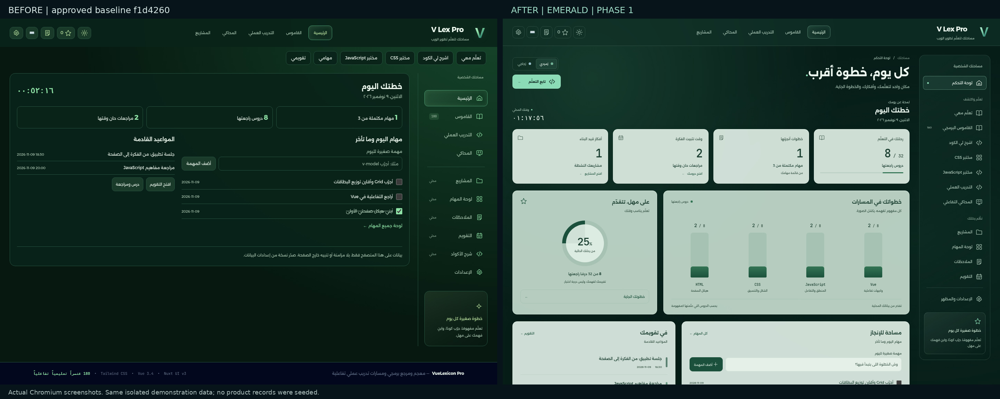
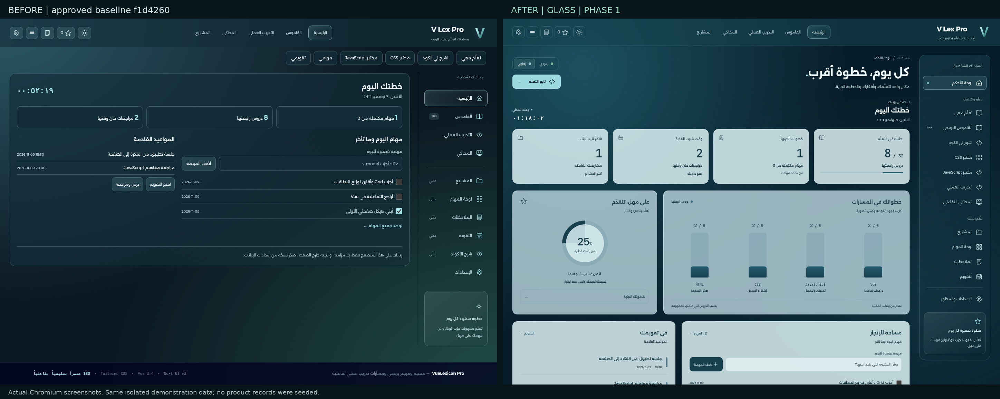
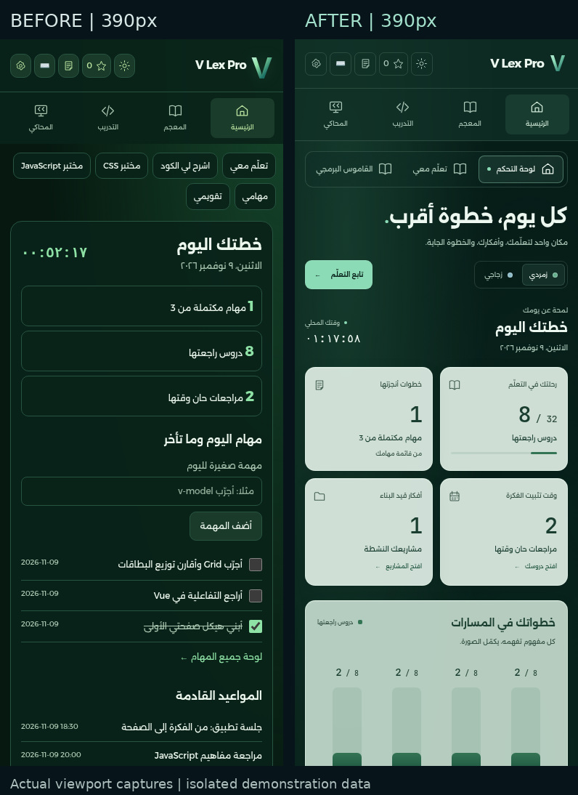

# V Lex Pro — تسليم المرحلة الأولى من التصميم

الأساس: `f1d42608165af70c0ffa3d5ec82338905de0b8fe`.
الفرع: `feat/vlex-emerald-ui`. النطاق: الثيمان الأخضر والزجاجي، وإطار الصفحة الرئيسية ولوحة التحكم فقط.

## النتيجة

أصبحت لوحة التحكم ذات تسلسل واضح: عنوان المساحة واختيار المظهر، ثم ملخص اليوم، وأربع بطاقات من البيانات الفعلية، وتقدم المسارات، والمهام والمواعيد. بقيت أدوات القاموس والتدريب والمفضلة والإتقان والوصول السريع متاحة في قسم «مرجعك، ومساحات التجربة» القابل للتوسيع بلوحة المفاتيح.

صُقل الثيمان الموجودان `green` و`glass` دون تغيير معرفاتهما أو مخطط التفضيلات. بقيت الثيمات الخمسة متاحة، ويستمر اختيار المستخدم المحفوظ؛ لا تُفرض قيمة جديدة فوق تفضيل سابق. يوجد تبديل مباشر بين الزمردي والزجاجي أعلى اللوحة، وبقية الخيارات في الإعدادات الحالية.

## صلة التنفيذ بالفيديو

- نُقل التباين بين إطار عميق وبطاقات زجاجية فاتحة، مع حدود دقيقة، وإضاءة خلفية منتشرة، وحواف ومسافات منتظمة.
- صارت البطاقات الأربع والمخطط العريض وملخص التقدم الدائري قريبة من توزيع المرجع، بمعلومات التعلم الحقيقية بدل بياناته المالية.
- القائمة على اليمين لتناسب RTL. ظل الكود الإنجليزي وخط JetBrains Mono باتجاه LTR.
- الثيم الزجاجي يحتفظ بالطابع البارد السماوي للمرجع، ويحوّل الزمردي الاتجاه نفسه إلى الأخضر المطلوب.
- حركة الدخول CSS قصيرة مدتها 420ms، مع تدرج 35ms بين بطاقات الملخص، وتفاعل واضح للأزرار والتركيز. تُلغى الحركة وفق `prefers-reduced-motion`؛ لا حركة إضاءة مستمرة أو مكتبة جديدة.

لا يُدّعى تطابق بكسلي مع تسجيل 512×910 أو استنتاج قيمه الأصلية الدقيقة للشفافية والتوقيت. تُعرض الأرقام من السجلات الفعلية؛ الأعمدة والدائرة تقيسان الدروس التي علّمها المتعلم كمفهومة، ولا تمثلان درجة اختبار أو تتبع تنفيذ.

## الملفات وأسباب تغييرها

| الملف | السبب |
|---|---|
| `index.html` | تركيب اللوحة والقائمة والاختصارات واختيار المظهر، وإغلاق مكون اللوحة صراحة، ووضع المحتوى الثانوي في عنصر تفاصيل قابل للوصول |
| `learning-dashboard.js` | قالب اللوحة ومؤشرات عرض مشتقة من البيانات الحالية؛ بقي منطق الحفظ والمنظّم كما هو بالبايت |
| `emerald-dashboard.css` | ملف تصميم مخصص للمرحلة، بمتغيرات المظهر والتوزيع والتجاوب وحالات التفاعل والحركة المخفضة؛ استثناء المحاكي صريح |
| `assets/vendor/manifest.json` | تحديث بصمة مدخل HTML للبناء؛ CSS المولد والمترجم وملفاتهما بقيت مطابقة للأساس |
| `scripts/review-emerald-dashboard.cjs` | صور فعلية وفحوص العرض والحفظ والتفاعل والبيانات والتباين والحركة، داخل جلسات متصفح مستقلة |
| `scripts/check-emerald-scope.cjs` | مقارنة صور المحاكي والصفحات المؤجلة بالأساس، مع تثبيت ساعة اللقطة فقط |
| هذا التقرير و`PHASE1_RESULTS.json` وصور المقارنة | توثيق المرحلة ونتائجها للمراجعة |

لم يتغير `app.js` أو `learning-store.js` أو بيانات القاموس والدروس أو المحركات أو الصوت أو ملفات تصميم المحاكي. بقيت أجزاء `useOrganizer` والمنظّم في `learning-dashboard.js` مطابقة للأساس. لم تُعدّل مكونات القاموس والشرح والمختبرات والدروس أو صفحات التنظيم للمرحلة الثانية.

## التحقق الفعلي

| الفحص | النتيجة |
|---|---|
| بناء المترجم وCSS | ناجح |
| سلامة الأصول | 27 أصلًا/ملف ترخيص مطابقًا |
| الأصول المولدة | CSS والمترجم مطابقان بايتًا للأساس؛ تغيرت بصمة مدخل HTML في البيان فقط |
| مجموعات فحص المنصة الحالية | 30/30، دون فشل أو إعادة في جولة المرحلة الأولى |
| فحوص اللوحة الجديدة | 29/29 |
| مقارنة حدود المرحلة بصريًا | 10/10 صور مطابقة تمامًا: المحاكي عند 1440 و390 بكسل في الثيمين، وست صفحات مؤجلة في البترولي |
| المقاسات | 360 و390 و768 و1024 و1440 بكسل للثيمين؛ لا تمرير أفقي للصفحة |
| الحفظ والتفاعل | إعادة تحميل، ثيمات خمسة، إضافة مهمة بـEnter وإكمالها، فتح المشاريع، وأقسام المرجع بلوحة المفاتيح |
| دقة البيانات | البداية فارغة فعلًا، ولا تضخم المعرفات المكررة أو غير المعروفة رسم التقدم |
| التباين | النص الأساسي والثانوي والإجراء على البطاقة الزجاجية يحقق 4.5:1 على الأقل وفق نموذج المزج مع أغمق خلفية الثيم؛ ليس ادعاء تدقيق وصول شامل |
| الحركة | ظهور فعلي مرة واحدة أثناء التنقل دون تغير ارتفاع الصفحة، وتعطيلها عند طلب الحركة المخفضة |
| سلامة المراجع | الفيديو واللقطات وتقرير التحليل القديم لم تتغير بصماتها |

الاختبارات على Chromium/Linux. لم يُختبر Windows فعليًا أو Safari/Firefox/WebKit أو قارئ شاشة. لم تتغير الحزم أو lockfile، ولم تُستخدم مكتبة جديدة أو خدمة مدفوعة.

### المقارنة مع خط الأساس

اجتازت مجموعة أمثلة CSS الحالية 25/25 ضمن الجولة، مع إبقاء توثيق تفاوت Grid القديم في تقرير الجاهزية. فشل المقارنة التاريخية في مجموعة المحاكي القديمة كان مرتبطًا بمرجع `5d05acf` قبل تطوير المنصة؛ لم يُعدّل ذلك الاختبار أو يُنسب إلى هذه المرحلة. لم يُعد تشغيل مجموعة الصوت كعمل للمرحلة الثالثة؛ بقي النظام مطابقًا للأساس، وتحققت حدود المحاكي ببصمات الملفات وصوره الفعلية.

تنبيه Browserslist بأن بيانات `caniuse-lite` قديمة ما زال موجودًا وغير معطل للبناء. المقارنة البصرية الأولى للمحاكي اختلفت في أرقام الساعة فقط؛ أُعيدت مع تثبيت Date إلى اللحظة نفسها في السياقين، فصارت الصور مطابقة دون إخفاء عناصر الواجهة أو تغيير كود المحاكي.

## صور قبل وبعد

الصور لقطات فعلية من Chromium للالتزام الأساسي والنسخة الجديدة، ببيانات عرض صناعية متماثلة في جلسات معزولة. لم تُزرع هذه السجلات في الموقع، ولم تُمس بيانات مستخدم حقيقية. صور الجوال تمثل نافذة عرض 390×1000 بكسل، والصور الكاملة محفوظة ضمن أدلة الجولة.







## المعاينة وإعادة الفحص

شغّل `python3 scripts/start-local.py --no-browser` من نسخة فرع التصميم، ثم افتح العنوان المحلي الذي يطبعه الخادم. اختر «زمردي» أو «زجاجي» أعلى اللوحة. استخدم ملف متصفح/منفذ اختبار مستقلًا عن بياناتك اليومية إذا أردت التجربة دون خلطها.

للبناء: `npm ci --ignore-scripts` ثم `npm run build:compiler` و`npm run build:css` و`npm run verify:assets`.

لفحص اللوحة والصور:

```sh
node scripts/review-emerald-dashboard.cjs --root /path/to/checkout --output /path/to/new-review --stage after --check
```

لفحص حدود المرحلة، استخدم مجلدًا مستقلًا للالتزام الأساسي:

```sh
node scripts/check-emerald-scope.cjs --before /path/to/baseline --after /path/to/checkout --output /path/to/new-scope-review
```

أدوات الصور تستعمل Playwright المتاح في بيئة Codex وChromium المحلي؛ ليست اعتماديات تشغيل للمنصة. جرى تشغيل الفحوص التي تكتب تقاريرها في نسخة تحقق مستقلة للحفاظ على التقارير السابقة.

**اكتملت المرحلة الأولى فقط.** لم يبدأ تنفيذ المرحلتين الثانية والثالثة. لا دمج في main أو رفع فرع أو نشر موقع؛ ينتظر التعميم ومتابعة الصفحات موافقة المستخدم.
