# صور الموقع والفحص السريع

النسخة المفحوصة: `2e9b419875d3ddb8e0ea07c7e746d5f3a152df0d` على فرع `feat/vlex-emerald-ui`.

لقطات فعلية على Chromium/Linux، بجلسات متصفح معزولة دون بيانات شخصية. يعرض هذا الفحص فتح الصفحات وعدم وجود أخطاء غير معالجة؛ لا يعني اختبار كل وظيفة ممكنة.

- فتح وتصوير المساحات: **13/13**.
- اختبارات التنقل والتكامل والحفظ والتجاوب: **11/11**.
- اختبارات المحاكي والإكمال والصوت: **33/33**.

اختُبرت قناتا التنبيهات والمحيطي بتفعيل وكتم ومستوى مستقلين، وقياس خرج Web Audio فعلي، وعدم التشغيل التلقائي بعد إعادة التحميل، والإسكات عند المغادرة وإخفاء الصفحة، وصوت خطأ تنفيذ حقيقي. ليست هذه شهادة سماع بشري لجودة النغمات.

لم يتغير كود الموقع. لم يُختبر Windows فعليًا أو Firefox/Safari. لا دمج أو نشر للموقع.

## الصفحات

### لوحة التحكم

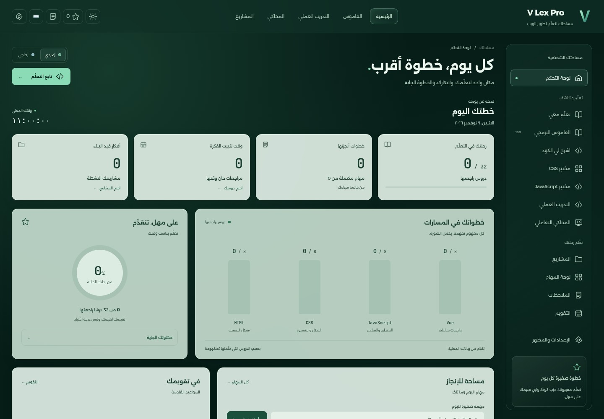

### القاموس

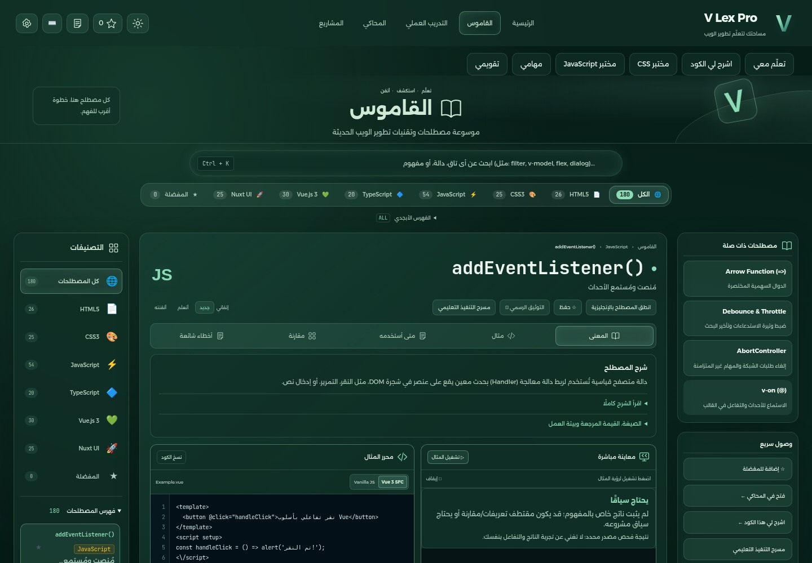

### الدروس

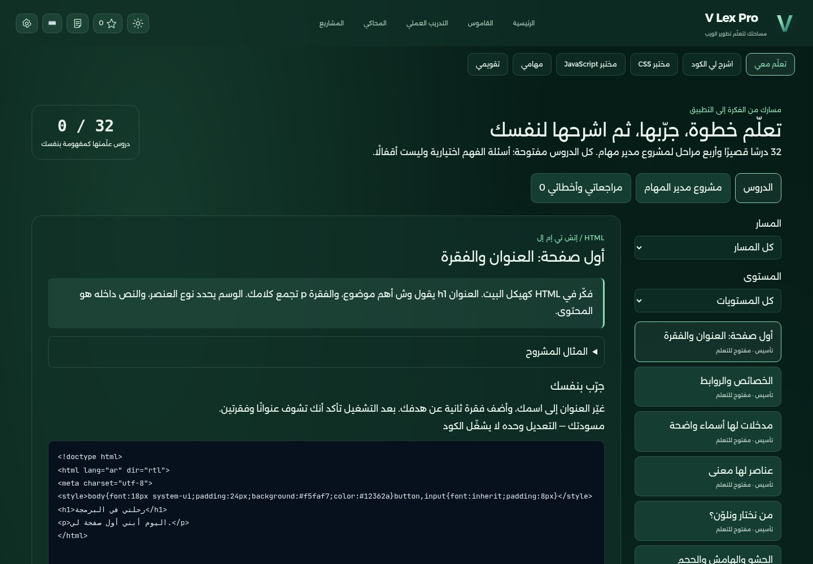

### شرح الأكواد

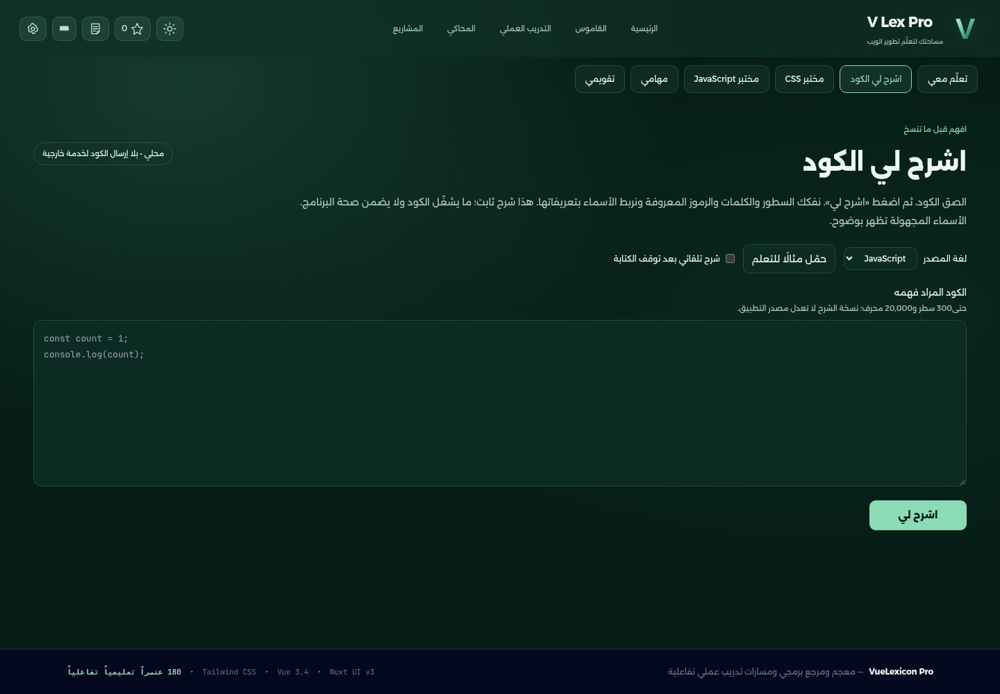

### مختبر CSS

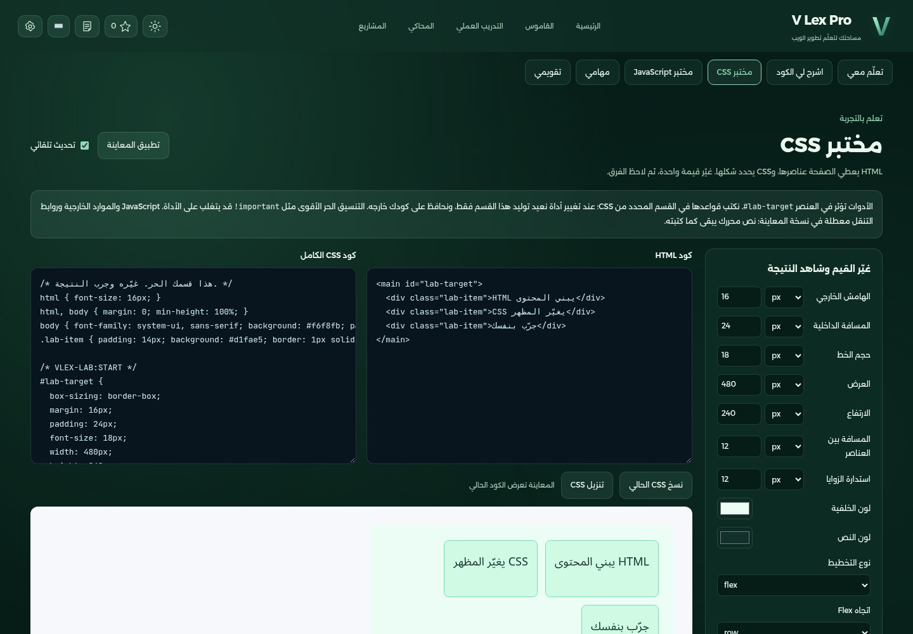

### مختبر JavaScript

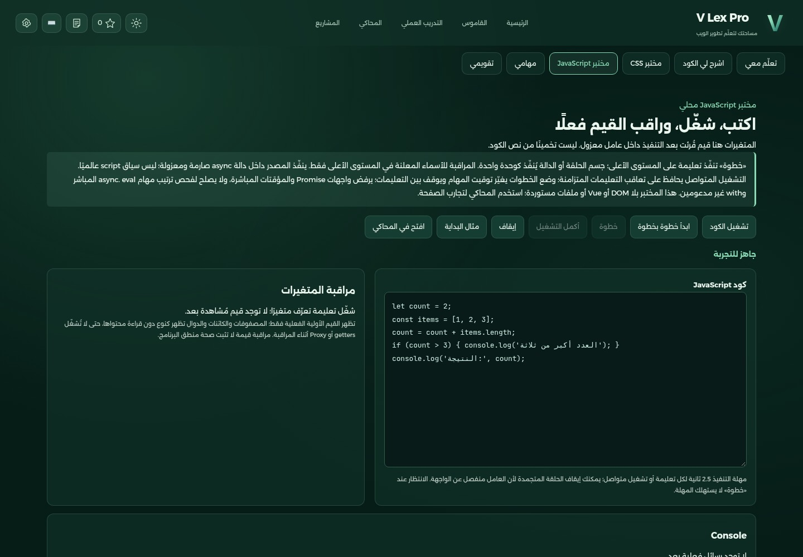

### الإعدادات

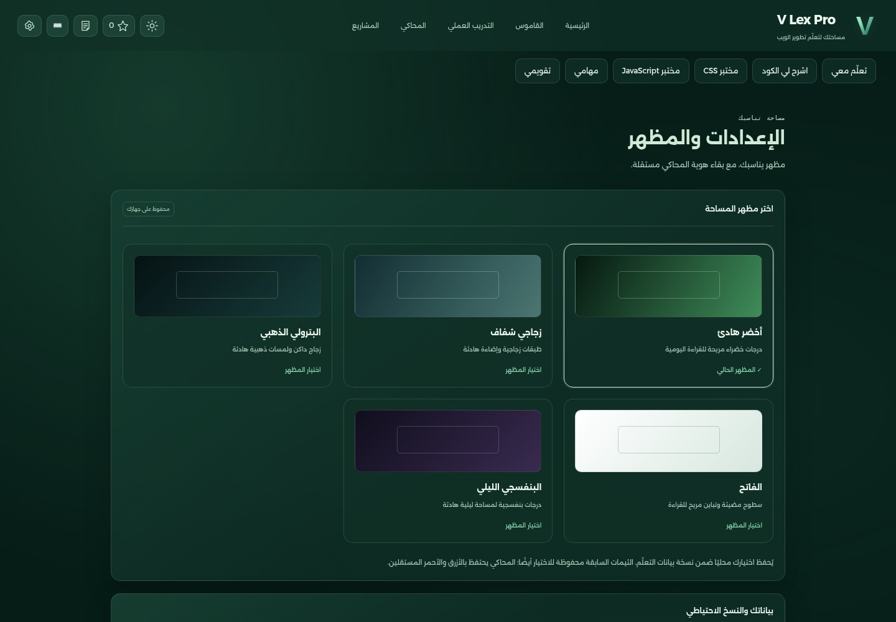

### المحاكي

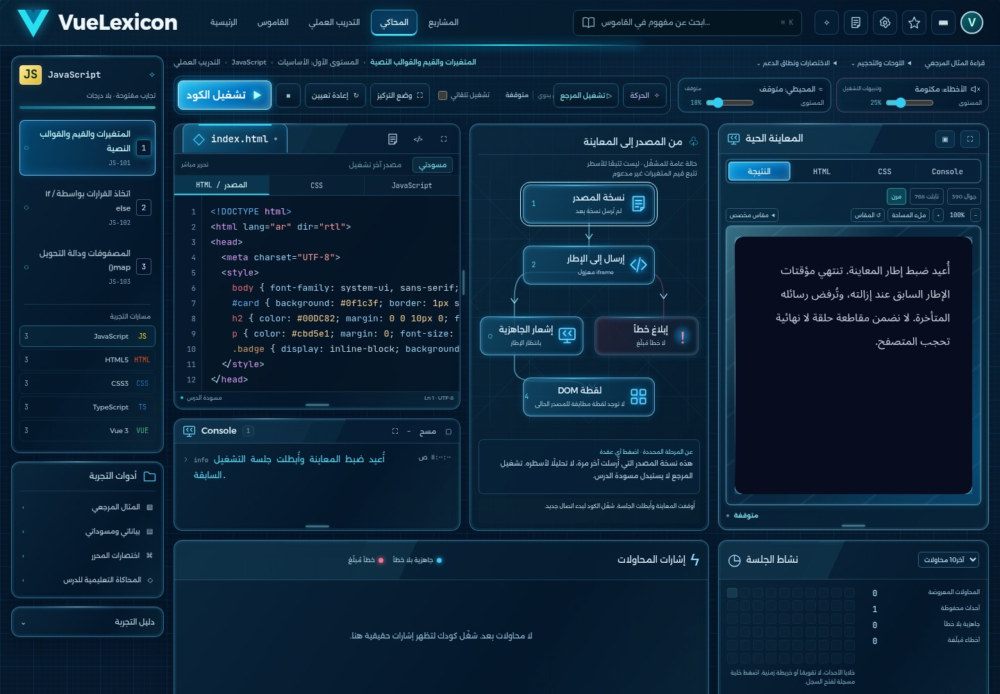

### التدريب

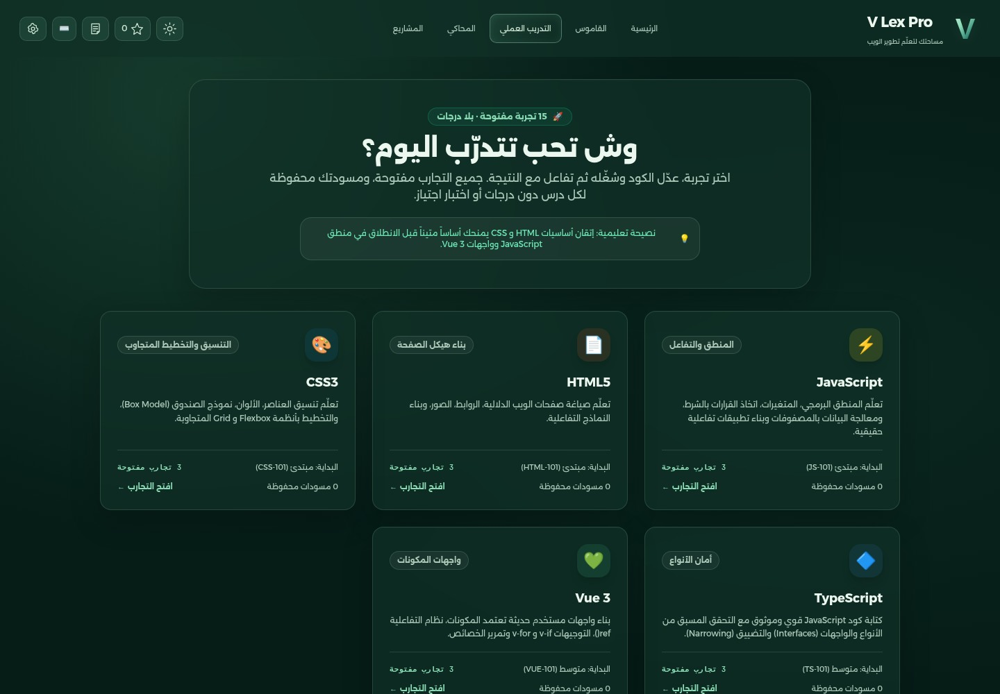

### المشاريع

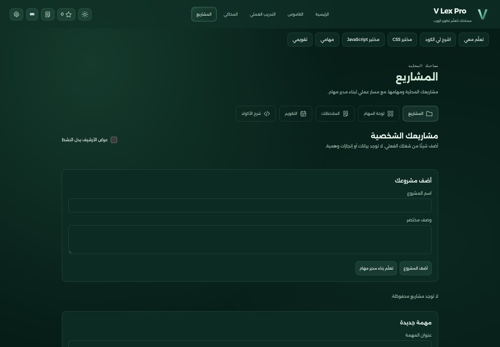

### المهام

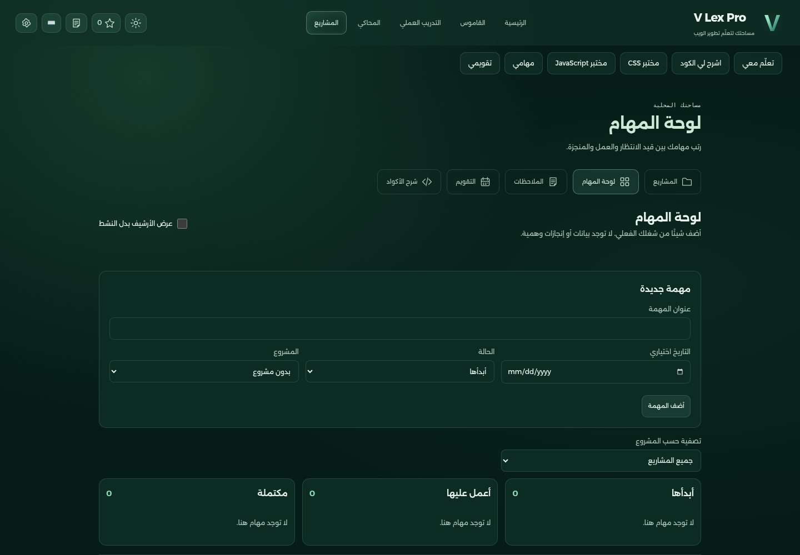

### الملاحظات

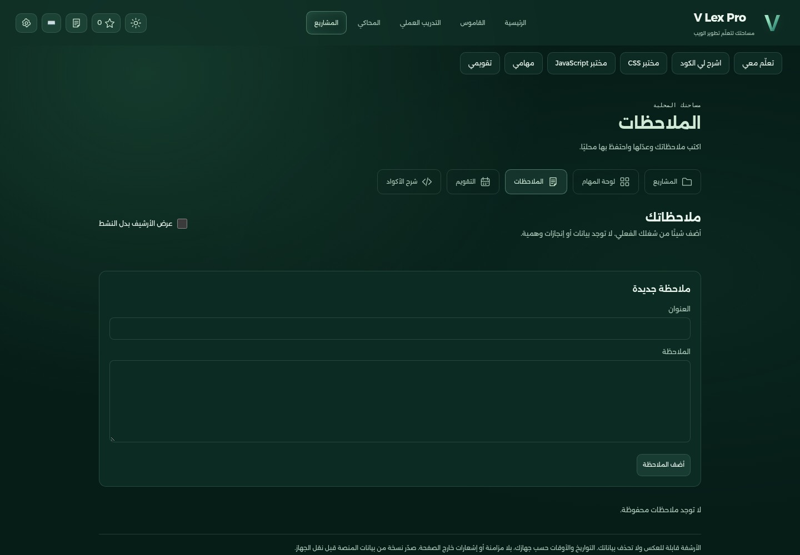

### التقويم

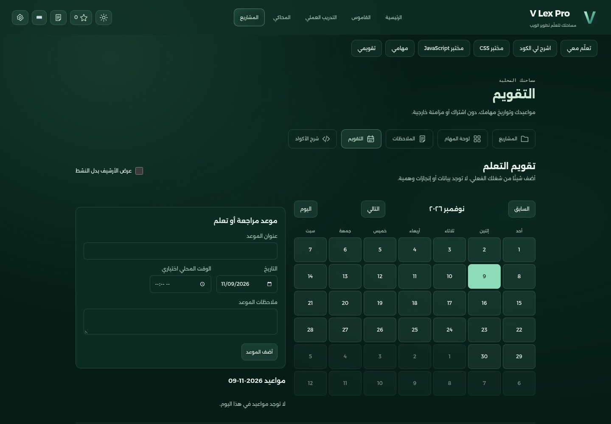

