# V Lex Pro — معاينة نموذج Arrow Functions

هذه معاينة للمراجعة والاعتماد، وليست تعميمًا للمناهج أو نشرًا للموقع. الصور والفيديو من التطبيق الحقيقي في Chromium على Linux، بجلسة جديدة دون استيراد بيانات مستخدم. كل نتائج النجاح المعروضة جاءت من إجابات وتشغيل فعلي أثناء التسجيل.

## الفيديو

[شاهد الفيديو القصير داخل GitHub](media/arrow-functions-demo.mp4) · [تنزيل MP4](media/arrow-functions-demo.mp4?raw=true)

تسجيل متصل للمتصفح مدته نحو 40 ثانية، صامت دون تعليق صوتي أو مشاهد مولدة؛ حُوّل إلى MP4 وضُغط لتقليل حجم الرفع. يعرض اختيار رمز لشرحه، إجابة توقع خاطئة والتلميحات، التشغيل الفعلي، النقل إلى المحاكي وتشغيل المرجع والعودة، حلًا بلا return يفشل فعليًا، ثم حلًا صحيحًا واختبار الإتقان وحفظ التقدم واستعادته بعد إعادة التحميل. [التسلسل الزمني وبصمات الصور](capture-evidence.json) · [خصائص الفيديو وبصمته](video-evidence.json).

الروابط خاصة بصلاحيات هذا المستودع؛ يلزم تسجيل الدخول إلى حساب يملك الوصول. إذا أظهرت واجهة GitHub زر Download بدل مشغل فيديو، استخدم رابط التنزيل أعلاه.

## الصور بالترتيب

### 1. افهم

الأهداف والمتطلبات السابقة وشرح الإرجاع الضمني والصريح وحدود الدالة السهمية. يمكن فتح كل صورة بحجمها الأصلي.

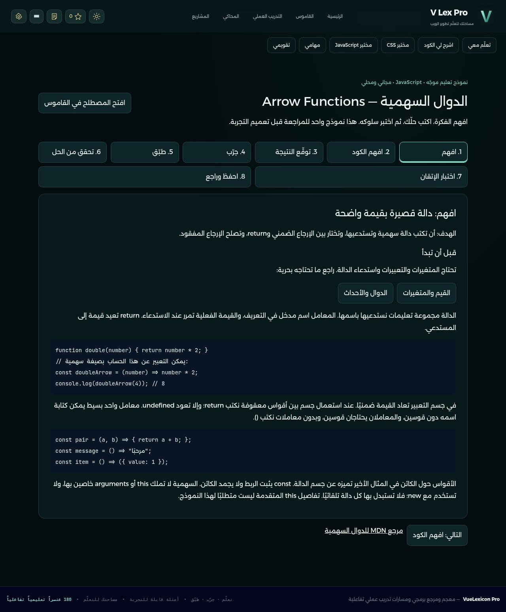

### 2. افهم الكود

اختيار الرمز `=>` يفتح شرحه المعد مسبقًا. أزرار أرقام الأسطر تشرح السطر كاملًا، وتدعم لوحة المفاتيح.

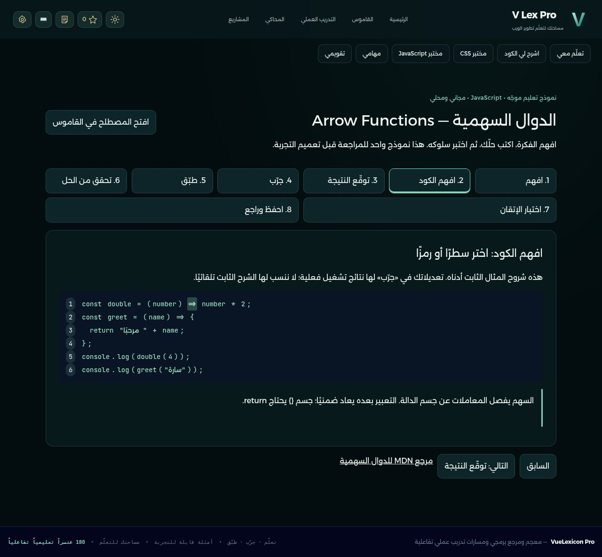

### 3. توقّع النتيجة

اختيرت الإجابة الخاطئة `6`، وظهرت التغذية الراجعة والتلميحات بالتدريج. صُححت الإجابة إلى `undefined` أثناء الفيديو قبل متابعة الدرس.

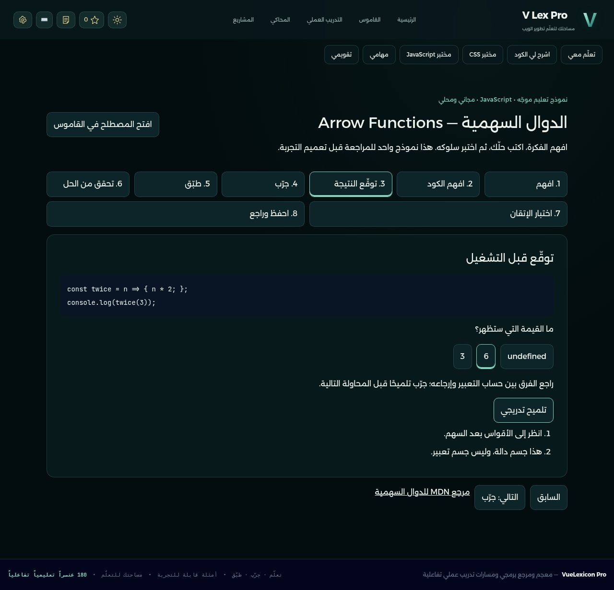

### 4. جرّب

كود قابل للتعديل يعمل داخل Worker؛ النتيجة الفعلية `8` في Console.

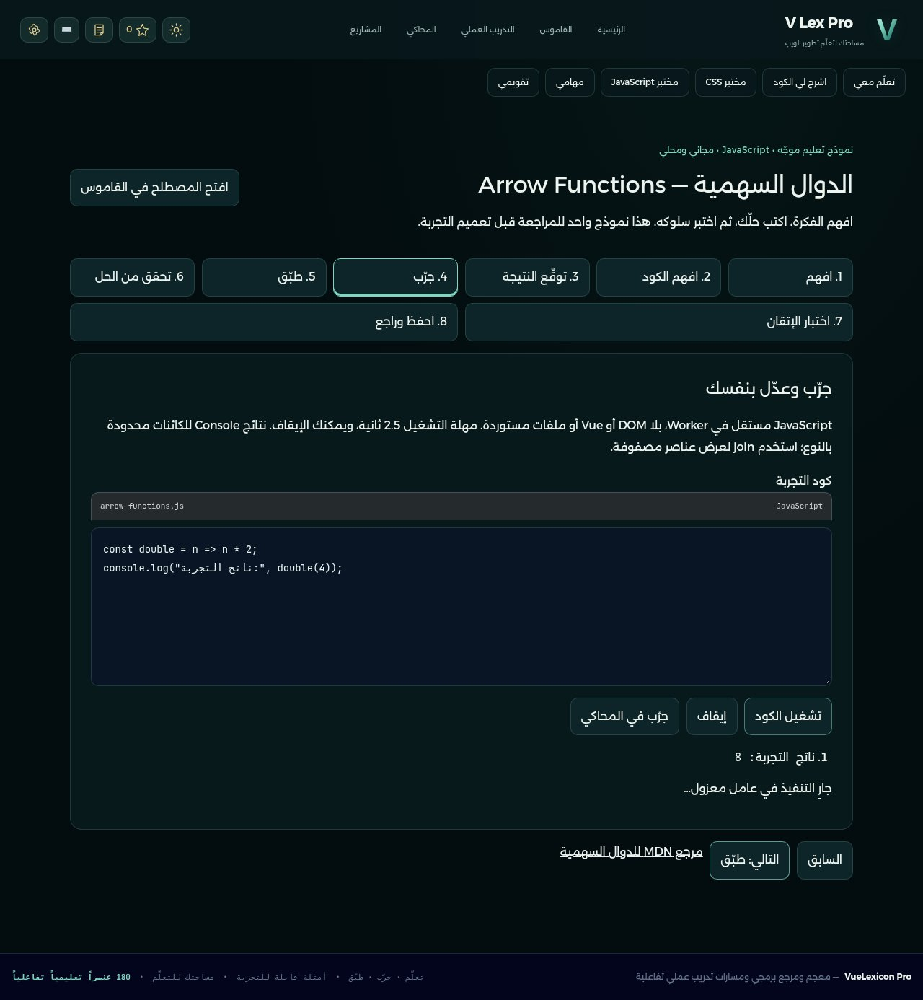

زر «جرّب في المحاكي» ينقل المصدر المدعوم دون تشغيل تلقائي. ثم شُغّل المرجع فعلًا في المحاكي القائم:

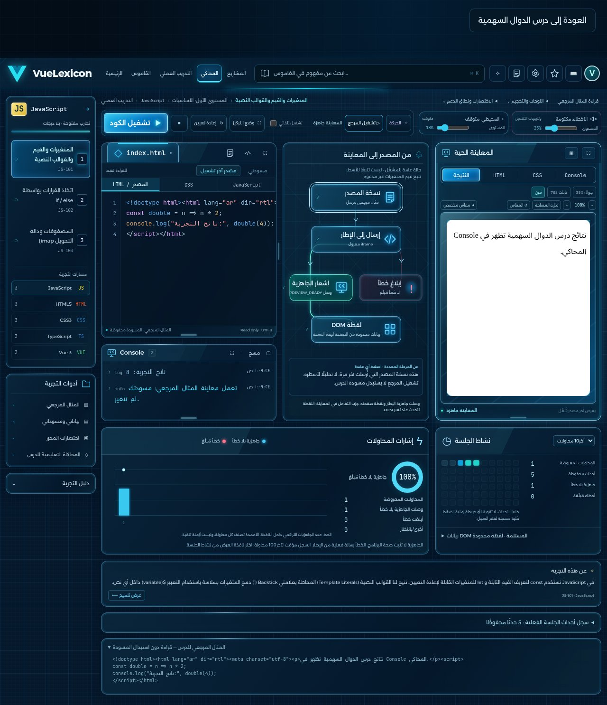

العودة تعيد مرحلة «جرّب» ومسودتها المحفوظة:

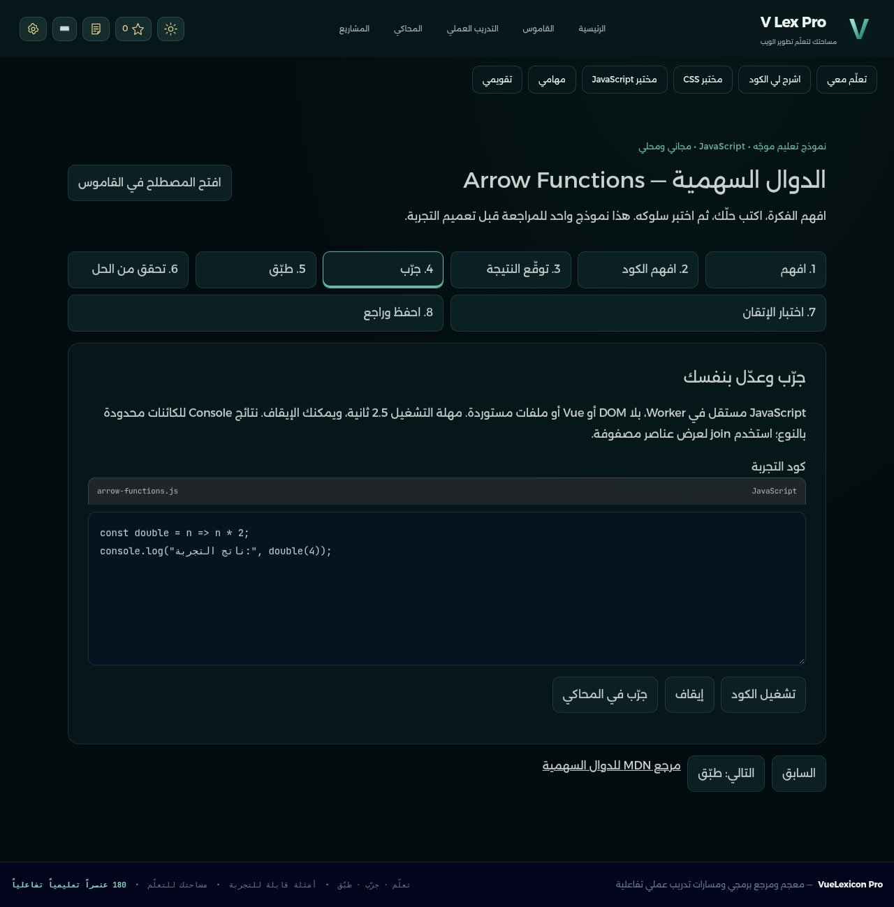

### 5. طبّق

بداية التحدي قبل كتابة الحل؛ توجد المهمة والمتطلبات دون عرض الحل كاملًا.

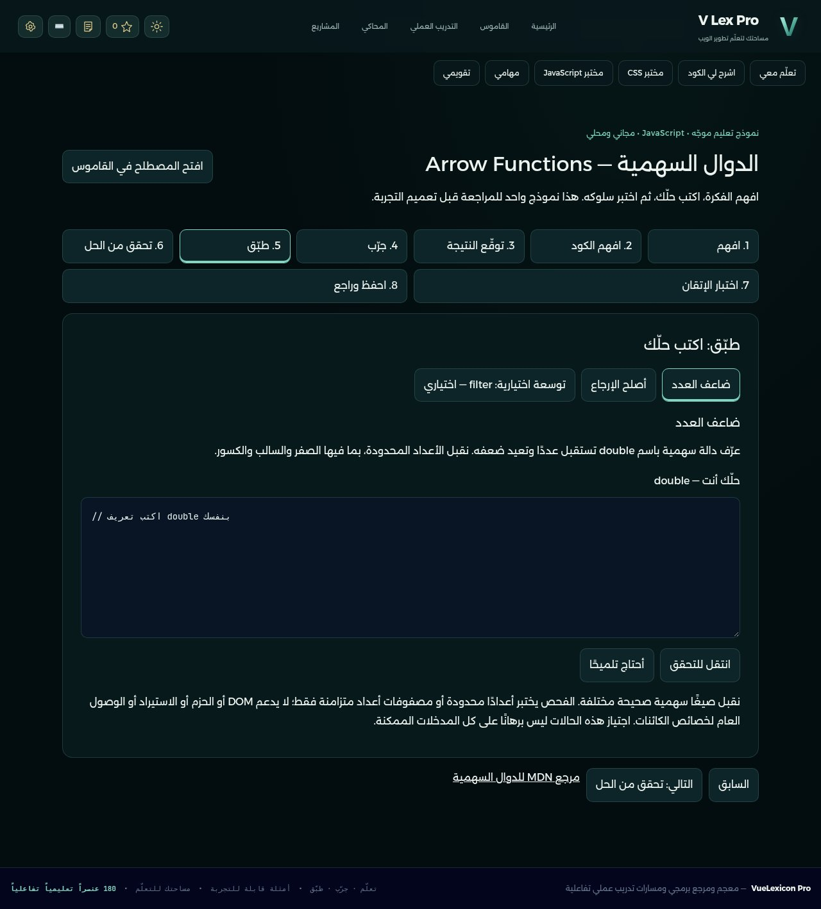

### 6. تحقق من الحل

الدالة ذات الجسم `{ n * 2; }` لا تعيد قيمة. فشلت الاختبارات فعليًا وظهر الناتج `undefined` مع التلميح:

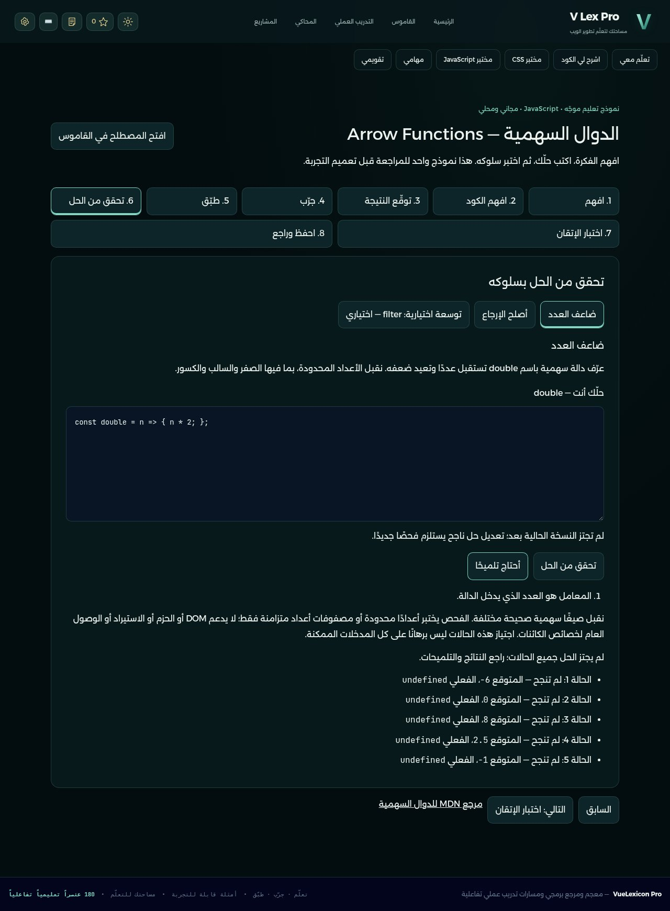

حل مختلف يستخدم الجمع وإرجاعًا صريحًا يجتاز الحالات المحددة، ويحتفظ بتعليقه التوضيحي:

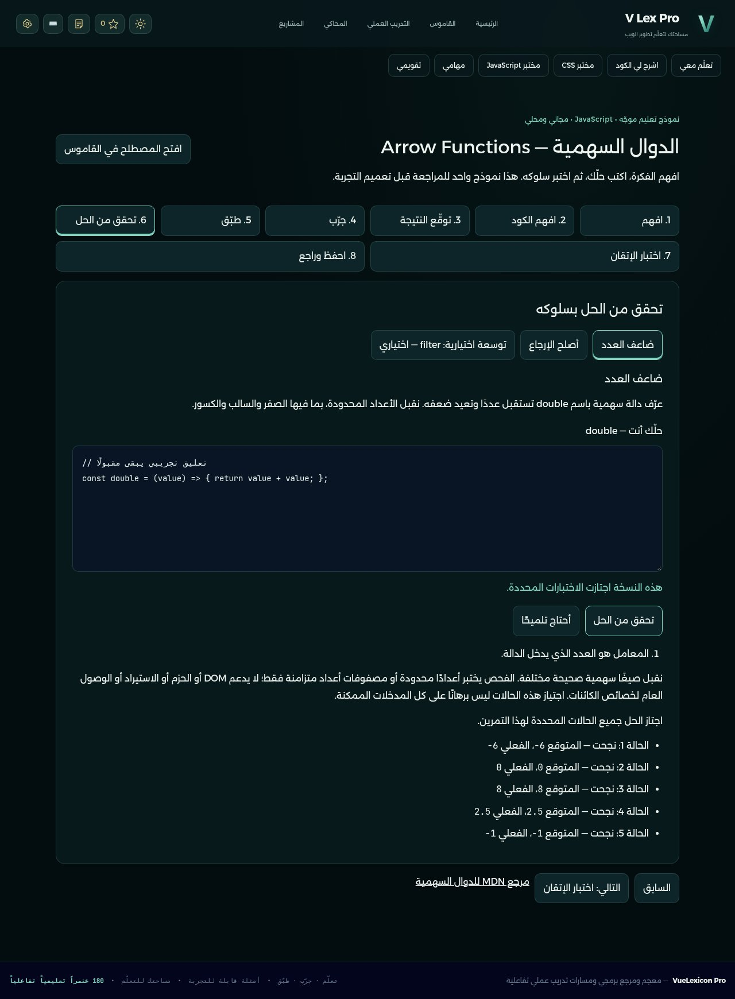

أُنجز أيضًا تمرين إصلاح `square` أثناء الفيديو؛ نجاح هذا التصحيح مطلوب لاجتياز النموذج.

### 7. اختبار الإتقان

إجابة فهم `const`، وتوقع إرجاع الكائن، ثم كتابة دالة `add` في سياق جديد وفحصها سلوكيًا.

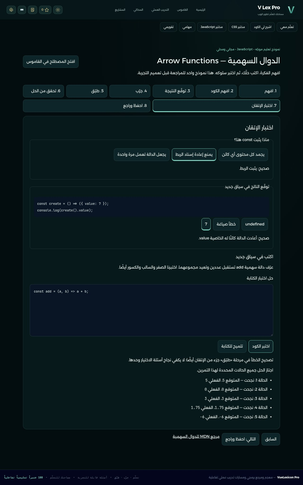

### 8. احفظ وراجع

الاجتياز مبني على النتائج الفعلية للمهام والأسئلة، مع مراجعات محلية، وليس نسبة تقدم تجريبية.

بعد إعادة تحميل الصفحة بقيت مرحلة المراجعة والإجابات والتلميحات ودليل الإتقان محفوظة:

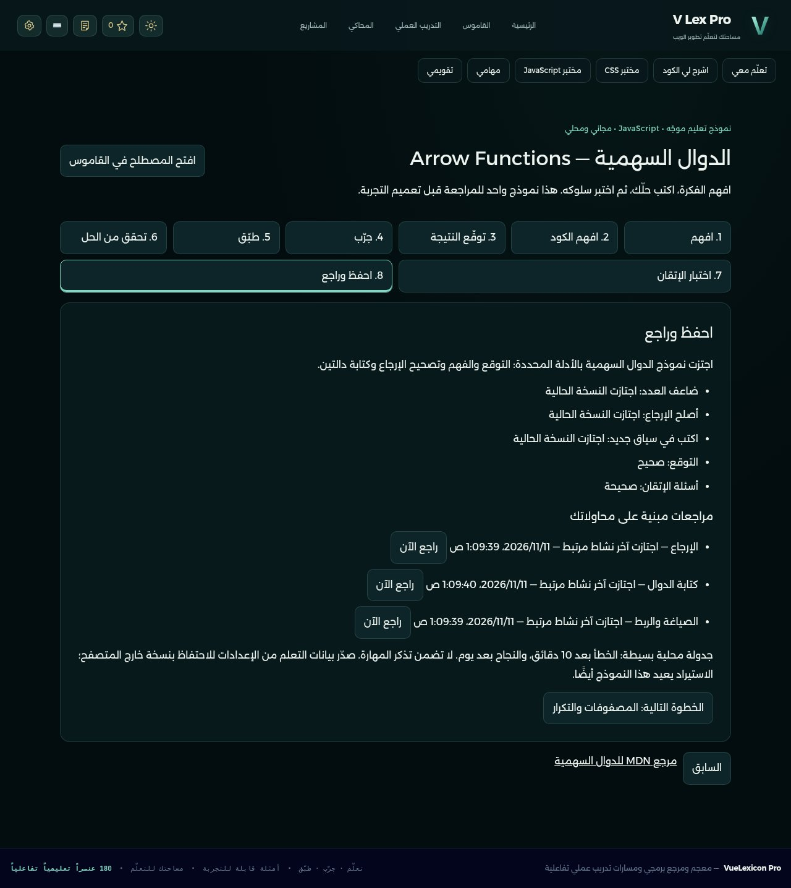

## ما رُفع وما اكتُشف أثناء التصوير

رُفعت الالتزامات الأربعة الأصلية دون إعادة كتابة تاريخها: [f7f9091](https://github.com/hofufihassan-wq/my-progect/commit/f7f90917e9c52a3b00f32a9d1c093c95d3df260d)، [def08a6](https://github.com/hofufihassan-wq/my-progect/commit/def08a60b27bab74b804c396c64bf39a3d130c8c)، [141f033](https://github.com/hofufihassan-wq/my-progect/commit/141f033e57477dd8eb2be81059fd75b3ecf71d62)، و[b0b9491](https://github.com/hofufihassan-wq/my-progect/commit/b0b9491f48e6476bbc8397c4c198bac9b2bedf5e). تحققنا من وجود كل واحد عبر GitHub.

كشف التصوير أن بيانات تعليقات Babel قد تجعل المصحح يرفض حلًا صحيحًا يترك تعليق البداية. أُضيف إصلاح محدود في `0fc9bc8` لتجاوز بيانات التعليقات، مع اختبارات رجعية لتعليقات السطر والكتلة. [تقرير الإصلاح والنتائج السابقة المحفوظة](../../../platform-tests/guided-arrow/comment-regression/FIX_AR.md). المعاينة النهائية مسجلة بعد هذا الإصلاح. لا تغيير للتصميم أو المحاكي أو الثيمات أو بقية المناهج.

## الاختبارات وحدودها

| الفحص | النتيجة | الدليل |
|---|---:|---|
| وحدة النموذج بعد إصلاح التعليقات | 9/9 | [نتائج الوحدة](../../../platform-tests/guided-arrow/unit-results.json) |
| النموذج في المتصفح بعد الإصلاح | 21/21 | [نتائج المتصفح](../../../platform-tests/guided-arrow/evidence/results.json) |
| تفاعلات جلسة التصوير النهائية | نجحت جميع التأكيدات | [سجل التصوير](capture-evidence.json) |
| الأصول بعد الإصلاح | 27 أصلًا مطابقًا | تحقق verify:assets؛ لم تتغير أصول التصميم |
| مصفوفة المنصة في دفعة النموذج السابقة | 30/30 بعد التصحيح والإعادات الموثقة | [الملخص المحفوظ](../../../platform-tests/guided-arrow/regression/final-summary.json) |
| المحاكي في دفعة النموذج السابقة | 33/33 | [سجل المحاكي](../../../platform-tests/guided-arrow/regression/simulator-completion.log) |
| ملف التصدير/الاستيراد وامتلاء التخزين في الدفعة السابقة | 2/2 | [نتائج واجهة النسخ الاحتياطي](../../../platform-tests/guided-arrow/evidence/backup-ui-results.json) |

لم تُعد المصفوفة الكاملة من الصفر لتصوير المعاينة؛ أُعيدت اختبارات النموذج المتأثرة بالإصلاح. تتضمن اختبارات المتصفح المحفوظة إغلاق عملية المتصفح وفتحها بملف دائم لاستعادة التقدم؛ الفيديو يوضح إعادة تحميل الصفحة فقط. لم يُنفذ اختبار Windows فعلي أو اختبار نطق بشري.

## معاينة تفاعلية محلية

من نسخة الفرع: `python3 scripts/start-local.py --no-browser` ثم افتح `http://127.0.0.1:8091/#arrow-functions`. على Windows توجد تعليمات [المعاينة المحلية](../../../ARROW_PILOT_PREVIEW_AR.md). صور وفيديو هذا التقرير لا تتطلبان تنزيل حزمة المشروع كاملة.

أُضيفت الصور المضغوطة ونسخة MP4 واحدة فقط، دون ملفات تسجيل المتصفح الخام أو ملفات تعريفه أو storageState أو ZIP أو بيانات حسابات أو ملفات اعتماد. لا merge إلى main ولا نشر ولا توسعة لبقية المناهج.
