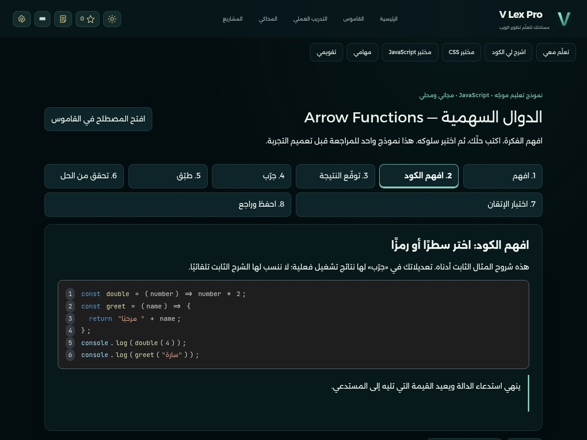
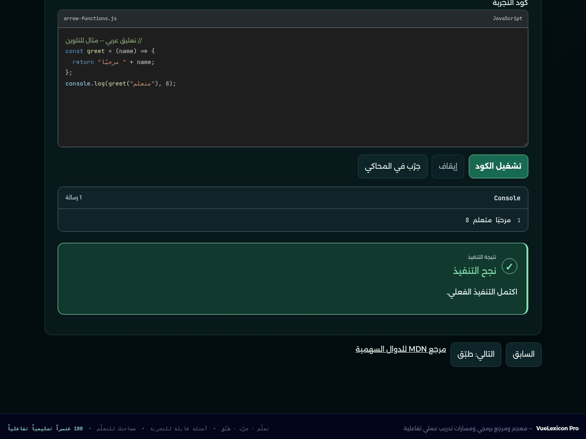
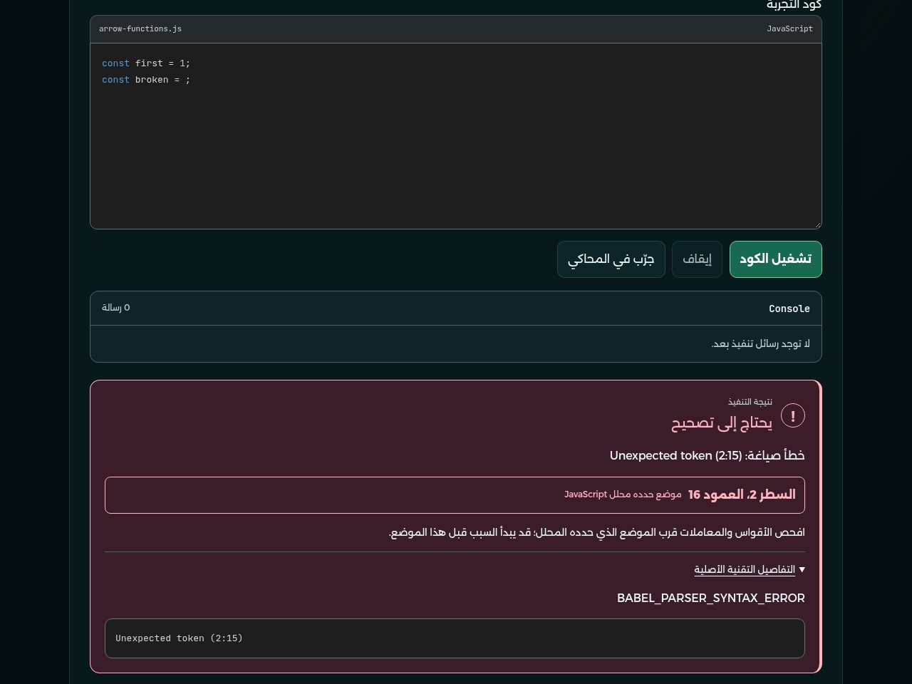
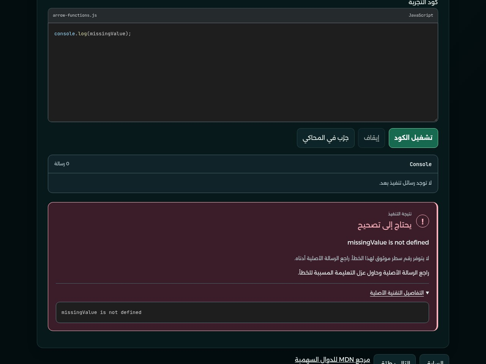
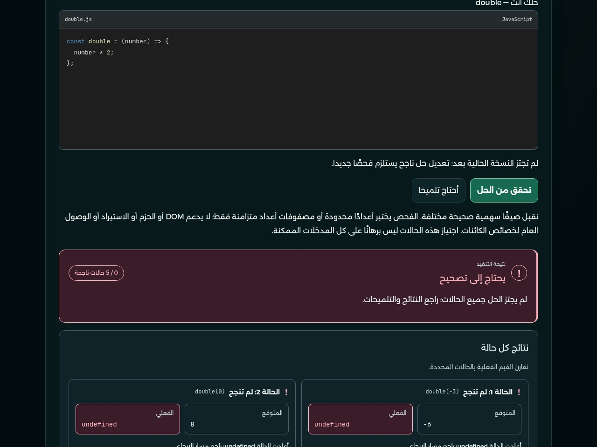
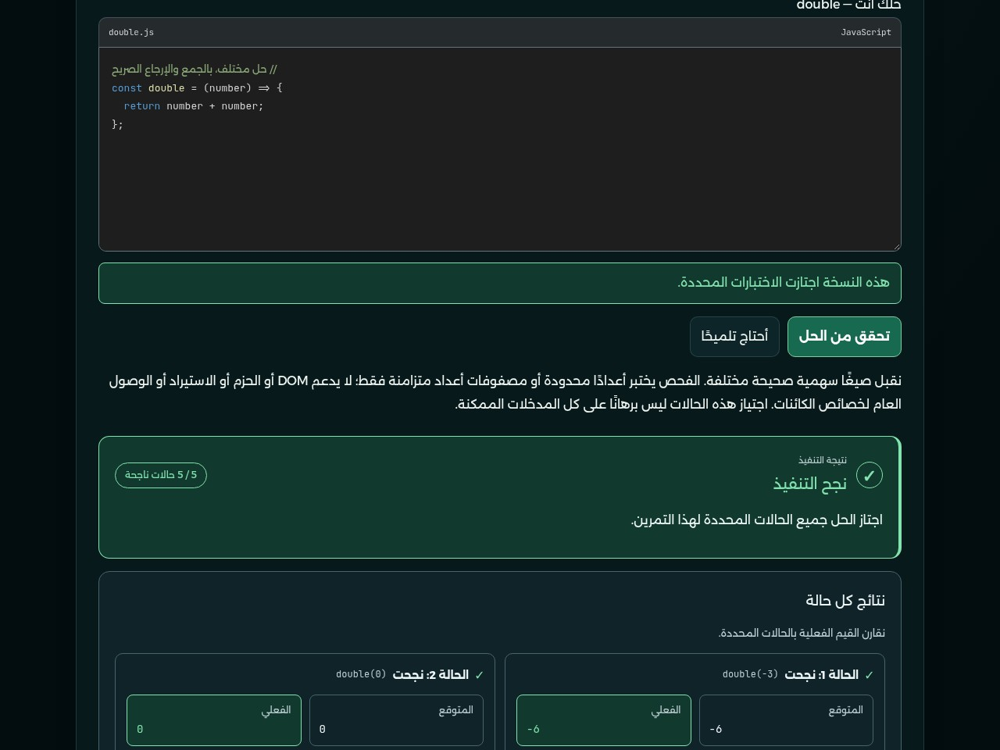

# V Lex Pro — مراجعة التحسينات البصرية لنموذج Arrow Functions

10 نوفمبر 2026، بتوقيت الرياض. اعتمد المستخدم التجربة التعليمية والوظائف؛ هذه الدفعة لتحسين العرض فقط قبل توسيع المناهج. المعاينة من التطبيق الحقيقي على فرع `feat/vlex-guided-arrow`، دون نشر الموقع أو دمج main.

## الفيديو واللقطات

[شاهد فيديو التلوين والأخطاء والنجاح — نحو 22 ثانية](media/darkplus-feedback-demo.mp4) · [تنزيل الفيديو](media/darkplus-feedback-demo.mp4?raw=true)

تسجيل متصل وصامت من Chromium على Linux، بجلسة جديدة وبيانات تعليمية تجريبية، دون استيراد بيانات مستخدم أو إضافة مشاهد مصطنعة. يعرض شرح رمز ملون، محرر الكود وتشغيله، خطأ صياغة مع موقع موثوق وتفاصيله الأصلية، خطأ تشغيل دون تخمين سطر، ثم حلًا خاطئًا وحلًا صحيحًا مع القيم الفعلية. [سجل التصوير وبصمات الصور](capture-evidence.json) · [خصائص الفيديو وبصمته](video-evidence.json).

### الكود الملون مع الشرح التفاعلي

تلوين فعلي من قواعد Highlight.js المحلية، مع بقاء اختيار الرمز أو السطر ولوحة المفاتيح كما في النموذج المعتمد.

### محرر النص الأصلي مع تلوين Dark+ والنتيجة الفعلية

لم يُستبدل textarea أو منطق الكتابة؛ التلوين طبقة عرض لا تستقبل المؤشر أو تعدل النص، مع تزامن الخط والحشو والتمرير. تبقى الشيفرة LTR والشرح العربي RTL.

### خطأ صياغة بموقع موثوق ورسالة أصلية

المحلل حدد السطر 2. تعرض الشارة العمود ابتداءً من 1، بينما تحتفظ التفاصيل بترقيم المحلل الأصلي ابتداءً من 0؛ لذلك يظهر العمود 16 في الشارة و`(2:15)` في النص الأصلي. لا تخمين من stack للمشغّل.

### خطأ تشغيل دون رقم سطر مختلق

سبب الخطأ الفعلي `missingValue is not defined` محفوظ كنص. لعدم توفر تحويل موثوق من سياق المشغّل إلى مصدر المتعلم، لا تعرض البطاقة رقم سطر.

### نتيجة غير صحيحة

بطاقة واضحة بلون ورمز ونص، يليها المدخل والقيمة المتوقعة والقيمة المعادة فعليًا لكل حالة. عند تعديل المصدر توسم النتائج السابقة بأنها قديمة، ولا يُنسب نجاحها إلى النسخة الجديدة.

### نجاح الحل

الحل المكافئ بالجمع والإرجاع الصريح يجتاز الحالات الخمس نفسها؛ لا تغيير لمنطق التصحيح أو معاييره.

## ما تغيّر

- ربط محررات النموذج وعوارض أمثلته بطبقة التلوين الموجودة، مع ألوان قريبة من VS Code Dark+: الكلمات والدوال والأرقام والنصوص والتعليقات. يحافظ عارض الشرح التفاعلي على مواضع النص الأصلي ويأخذ الألوان من تحليل المثال كاملًا، وليس تلوين الكلمات منفردة بقائمة شكلية.
- دعم اللغات الأربع عبر القواعد المحلية الموجودة: HTML وCSS وJavaScript، ومقاطع Vue SFC بما فيها القالب وJavaScript وCSS. تحقق الفحص من المحررات القائمة أيضًا دون إنشاء دروس جديدة.
- تنظيم Console وبطاقات الأخطاء والنجاح وحالات الاختبار، وتحسين تباين الأزرار والتركيز والبطاقات في الثيمات الخمسة. الألوان المخصصة محصورة بالتعليم الموجّه، وهوية المحاكي محفوظة.
- معلومات التشخيص إضافات للعرض فقط: عند خطأ الصياغة يُعاد طلب موقعه من المحلل نفسه دون تشغيل المصدر؛ تبقى الرسالة الأصلية متاحة في قسم التفاصيل. لا تعديل لبروتوكول العامل أو المقيم.

## الاختبارات الفعلية

| الفحص | النتيجة | الدليل |
|---|---:|---|
| وحدة تشخيص العرض | 4/4 | [نتائج الوحدة](../../../platform-tests/guided-arrow/visual/unit-results.json) |
| التحرير والتلوين والنتائج في المتصفح | 18/18 | [نتائج العرض](../../../platform-tests/guided-arrow/visual/browser-results.json) |
| توافق وظائف النموذج المعتمد | 21/21 | [فحوص النموذج](../../../platform-tests/guided-arrow/visual/functional-compatibility-results.json) |
| تكامل المنصة القائم | 11/11 | [نتائج التكامل](../../../platform-tests/guided-arrow/visual/integration-results.json) |
| تباين المحررات القائمة، خمسة ثيمات × ثلاثة محررات | 15/15 | [نتائج الثيمات](../../../platform-tests/guided-arrow/visual/existing-theme-evidence/results.json) |
| تصدير/استيراد فعلي وتحذير امتلاء التخزين | 2/2 | [نتائج النسخ الاحتياطي](../../../platform-tests/guided-arrow/visual/backup-interface-results.json) |
| البناء والأصول | نجح بناء CSS والتحقق من 27 أصلًا | [سجل البناء](../../../platform-tests/guided-arrow/visual/build-css.log) و[التحقق](../../../platform-tests/guided-arrow/visual/verify-assets.log) |

اختُبرت الكتابة بالعربية والإنجليزية، وثبات التحديد، وCtrl+C وCtrl+V من الحافظة الفعلية، والتراجع والإعادة، وتطابق التمرير والخط والحشو، ونسخ العارض كنص أصلي. اختُبرت أيضًا أحداث تركيب IME بمحاكاة برمجية؛ لا ندعي اختبار لوحة مفاتيح نظام أو Windows فعليًا. نجح وضع الألوان القسرية، ولم يُنفذ أي HTML وارد ضمن النصوص أو رسائل الخطأ.

في اختبار العرض بلغ تباين نصوص الكود وبطاقة النجاح المقاسة 4.5:1 على الأقل بالثيمات الخمسة، مع فحص تجاوز العرض على الجوال. هذا قياس للعناصر المحددة في الفحص، وليس شهادة وصول شاملة لكل الموقع.

دليل عدم تغيير الملفات الأساسية: [البصمات المطابقة للنسخة المعتمدة](../../../platform-tests/guided-arrow/visual/preservation.json)، وتشمل المقيم والمحتوى والمخزن ومشغّل JS والمحاكي وبيانات التقدم. بقيت جميع تقارير المعاينة السابقة في [تقرير النموذج السابق](../preview/README.md)، ولم يعاد بناء الوظائف أو تدقيق القاموس كاملًا.

## حدود هذه الدفعة والخطوة التالية

التحسينات البصرية على نموذج Arrow Functions أولًا. عند اعتماد العرض، تصبح مراحل التجربة المرجع الموحد للدروس، مع شرح وأمثلة وتقييم خاص بكل مهارة وأدوات مناسبة لكل لغة؛ لا نسخ لتمارين double أو المحتوى نفسه إلى بقية الدروس. لم يبدأ توسيع مناهج HTML أو CSS أو JavaScript أو Vue في هذه الدفعة.

للتجربة محليًا: `python3 scripts/start-local.py --no-browser` ثم `http://127.0.0.1:8091/#arrow-functions`. روابط GitHub تحتاج حسابًا مخولًا بالمستودع الخاص. لا main merge ولا نشر ولا خدمات مدفوعة أو ذكاء اصطناعي.
