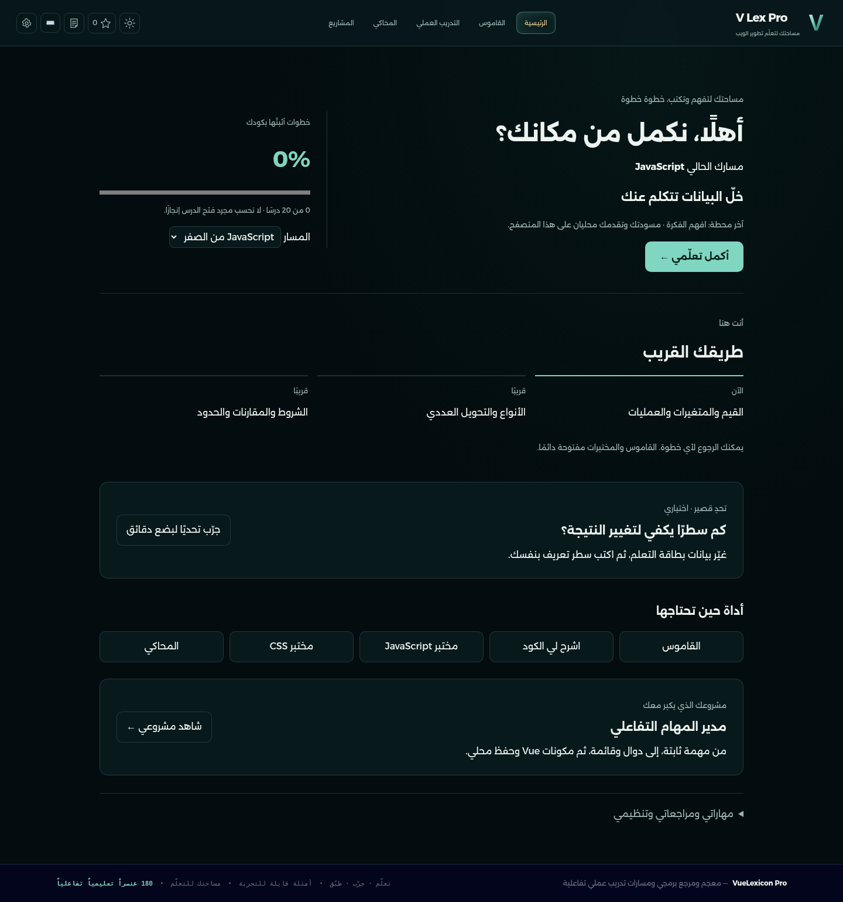
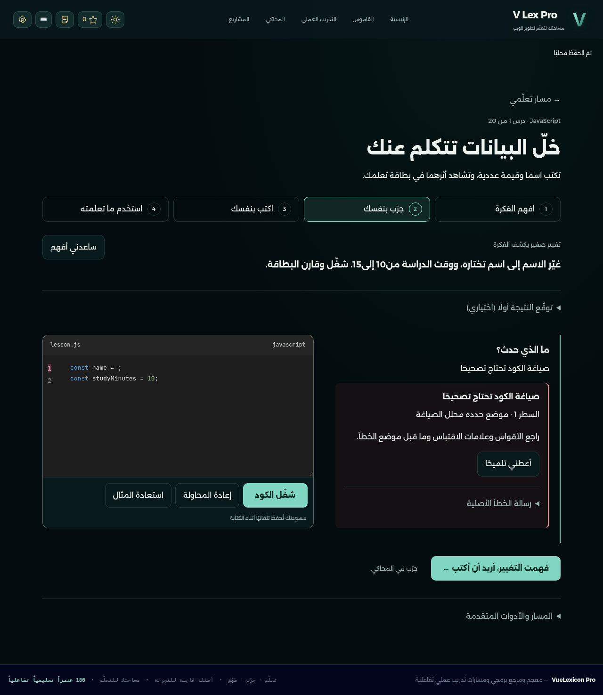
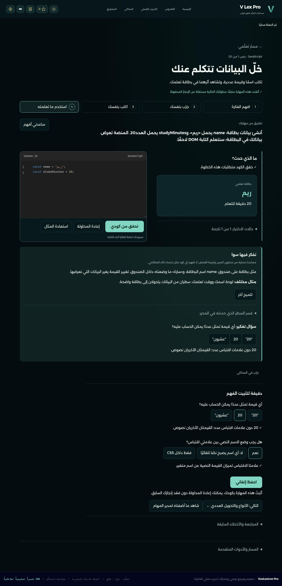
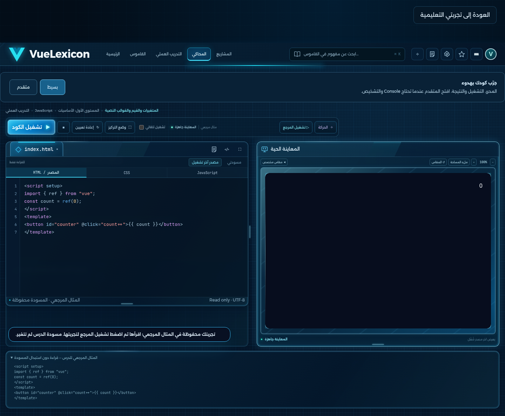
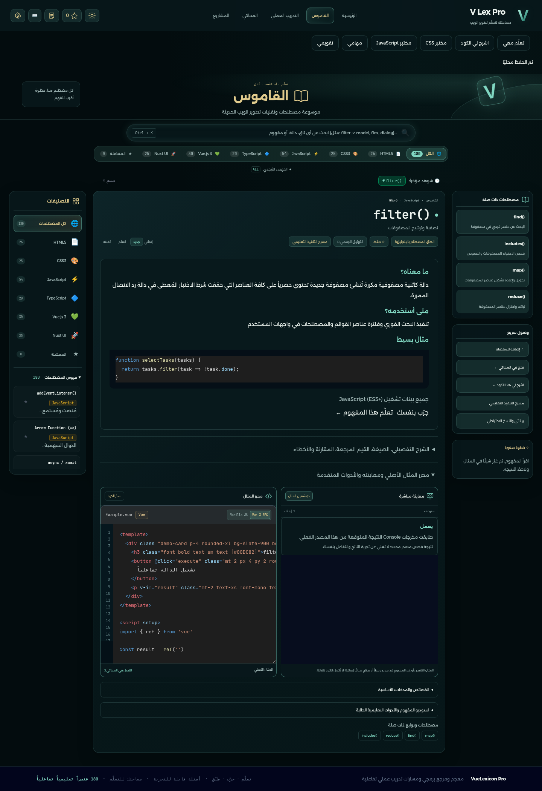
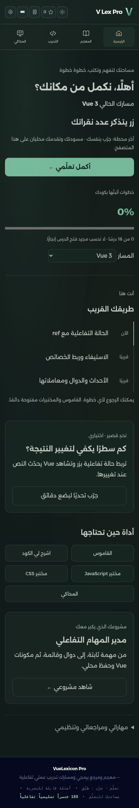

# معاينة تجربة V Lex Pro الجديدة

هذه صور وتسجيل من التطبيق الفعلي في Chromium، بمعلومات تجريبية فقط. افتح [الموقع](https://hofufihassan-wq.github.io/my-project/) ثم «أكمل تعلّمي». من أسفل الدرس يمكن اختيار JavaScript أوVue أوHTML/CSS التأسيسيين، ومن الرئيسية يمكن فتح مدير المهام المتدرج.

## 1. البداية الهادئة

زر استكمال وخريطة قريبة، مع الأدوات عند الحاجة.

## 2. الكود والخطأ

تلوين الكود واتجاهه LTR داخل صفحة عربية، وتصنيف الخطأ ورقم السطر عند توفره من المحلل. تبقى الرسالة الأصلية قابلة للفتح.

## 3. النجاح والحفظ

الحكم للكود الجاري؛ الإنجاز السابق لا يضيع عند إعادة تمرين. التقدم والمسودات ضمن النسخة الشاملة.

## 4. المحاكي والقاموس والجوال

## تسجيل التفاعل

[شاهد أو نزّل الفيديو القصير](evidence/learning-preview.mp4) — يعرض درسًا فعليًا، خطأ صياغة، تلميحات، كتابة وتقييمًا ناجحًا وحفظ إتقان، ثم ref ونقرة فعلية، ثم المحاكي والعودة ومراحل المشروع. لا يوجد تعليق صوتي مولّد أو نتائج تنفيذ مصطنعة.

[خريطة المحتوى وحدود أدوات التنفيذ](CURRICULUM_AR.md) · [متابعة الدفعات](PROGRESS_AR.md) · [النسخة السابقة كملف مستقل](backup/site-before-7157894.zip)
