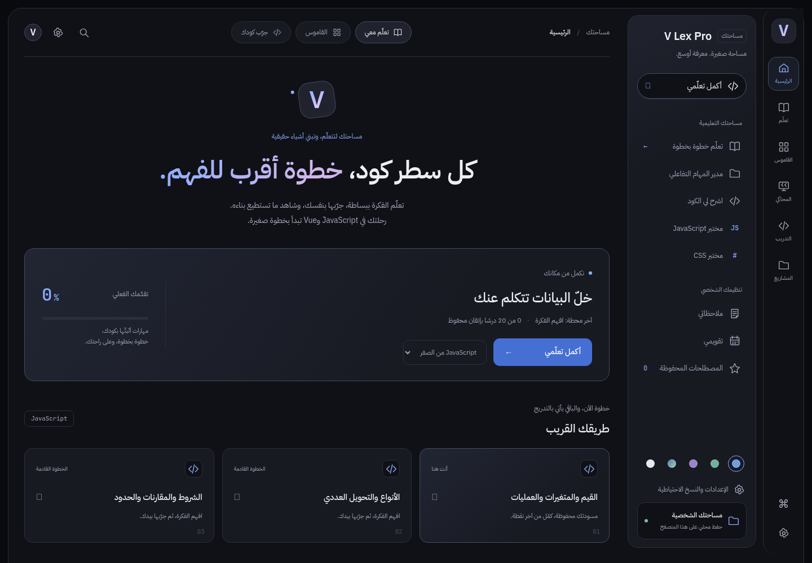
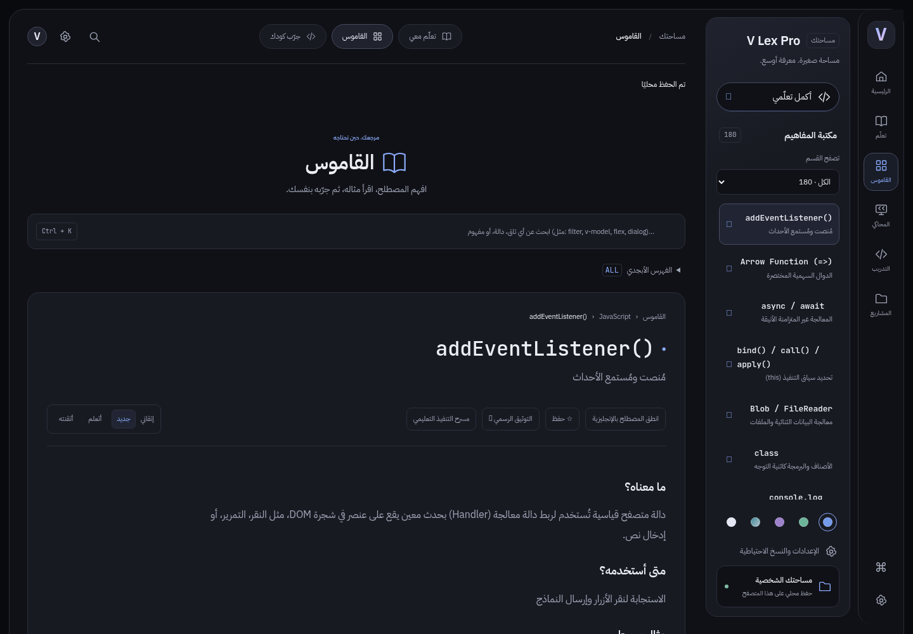
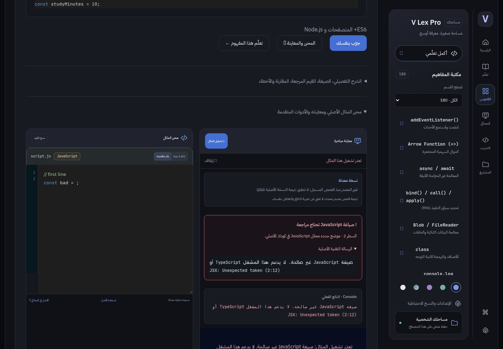
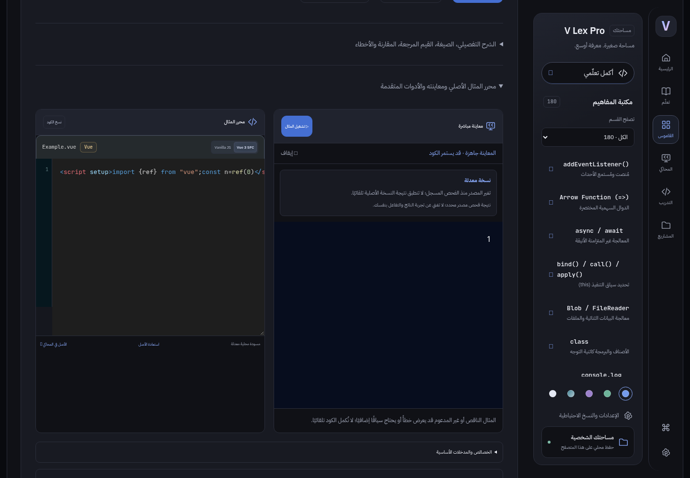
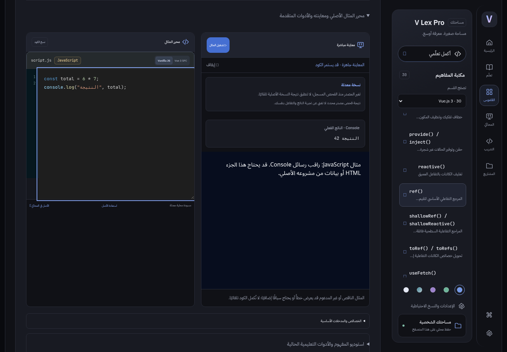
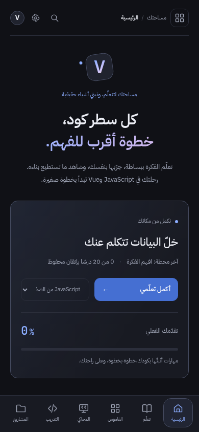
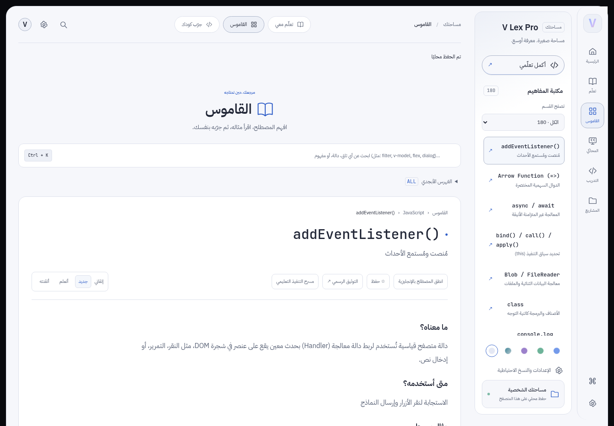

# معاينة تحديث V Lex Pro

صور وتسجيل من التطبيق الفعلي في Chromium، ببيانات تجريبية فقط. المصدر محفوظ في فرع feat/vlex-obsidian-refresh، والنسخة التي كانت منشورة قبل هذا التحديث محفوظة كاملة في [ملف مستقل](backup/site-before-d554fd1.zip) وفرع backup/pre-obsidian-refresh-d554fd1.

## أبرز التغييرات

1. هيكل جانبي ومساحة داكنة مستلهمان من الصورة المرجعية، مع هوية V Lex Pro وأدوات تعلّم فعلية.
2. خط عربي محلي جديد، وألوان وبطاقات وتباعد متسقة، وثيمات خمسة محفوظة.
3. قاموس بفهرس جانبي وتصنيفات، وقراءة أوسع ووصول مباشر للمحرر والمعاينة.
4. تنسيق الرئيسية والدروس والمختبرات والمشاريع والإعدادات والمحاكي والجوال.
5. إصلاح رفض CSS الصحيح، وإخفاء المعاينة، واستعادة المسودة دون تأكيد. أضيف اختصار التشغيل وتشخيص الخطأ الدقيق ومخرجات Console في موضع أوضح.

## الرئيسية

[الرئيسية قبل التحديث](evidence/before-home.png)

## القاموس

[القاموس قبل التحديث](evidence/before-dictionary.png)

## المعاينة والتصحيح

## الجوال والثيم الفاتح

## الفيديو

[شاهد أو نزّل التسجيل القصير](evidence/obsidian-update.mp4): الرئيسية، تغيير الثيم، تصفّح مصطلح Vue، فتح المعاينة، تعديل الكود وتشغيله، نقرتان فعليتان، خطأ صياغة، ثم تصحيح ينتج42 فعلًا. لا نتائج أو شاشات مصطنعة.

[تقرير العمل والاختبارات](STATUS_AR.md). المعاينة والحفظ محليان على المتصفح، ولم تتغير معرفات الدروس أو بيانات المستخدم أو محرك التقييم.
