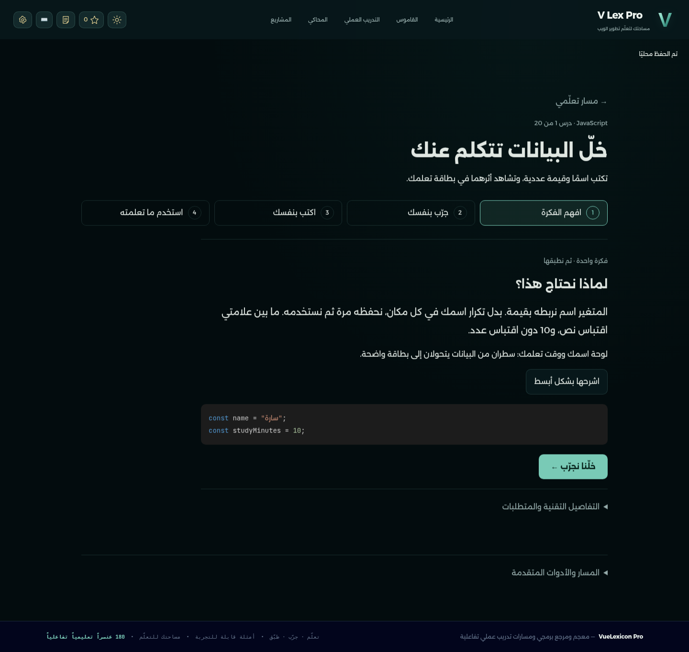
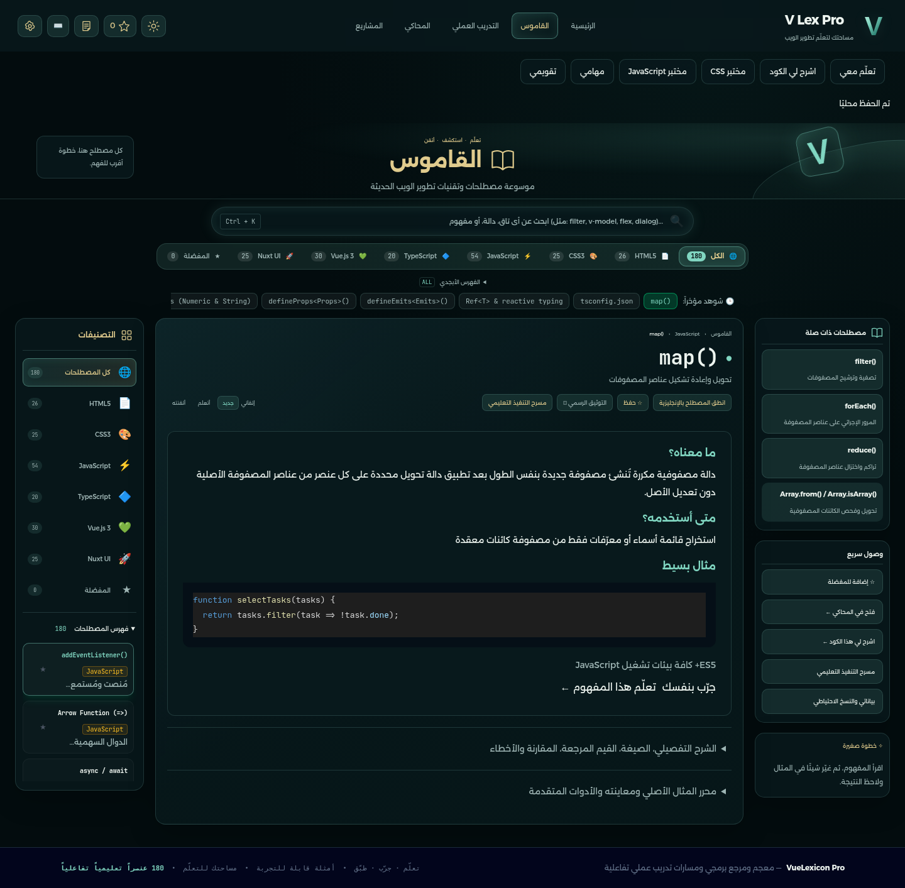
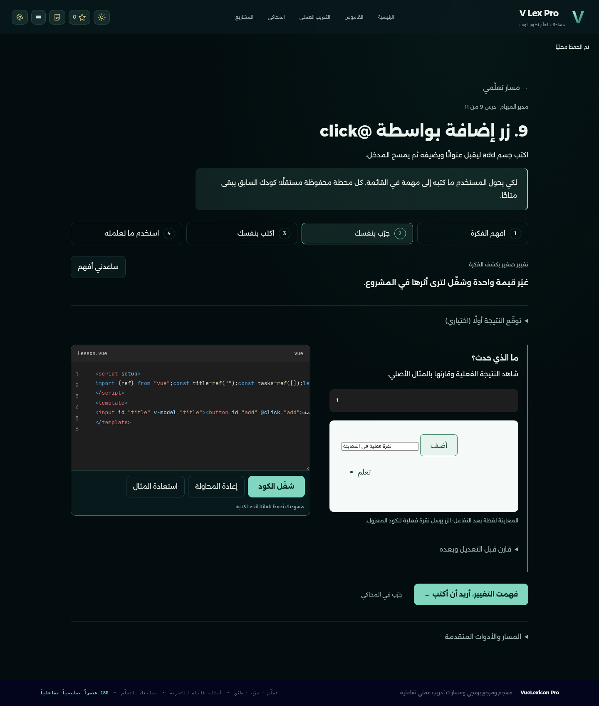
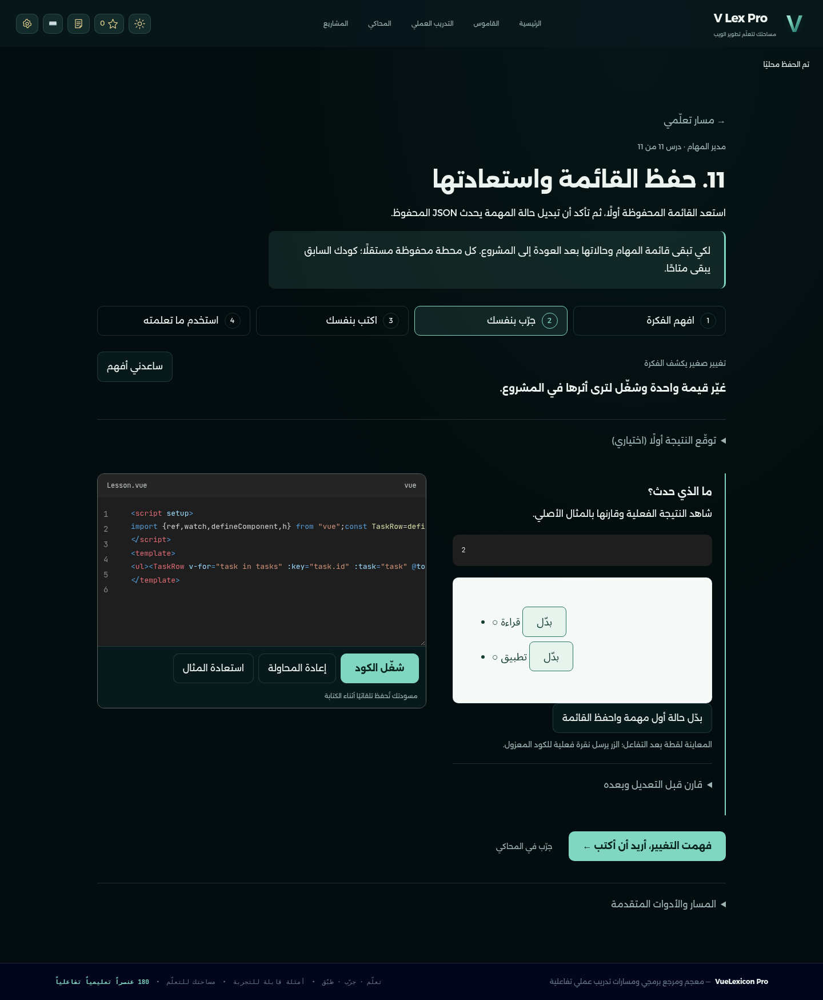
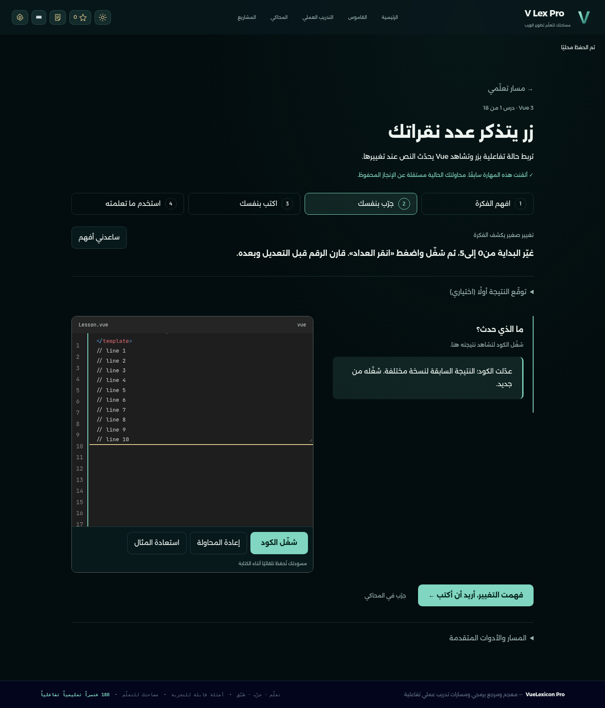
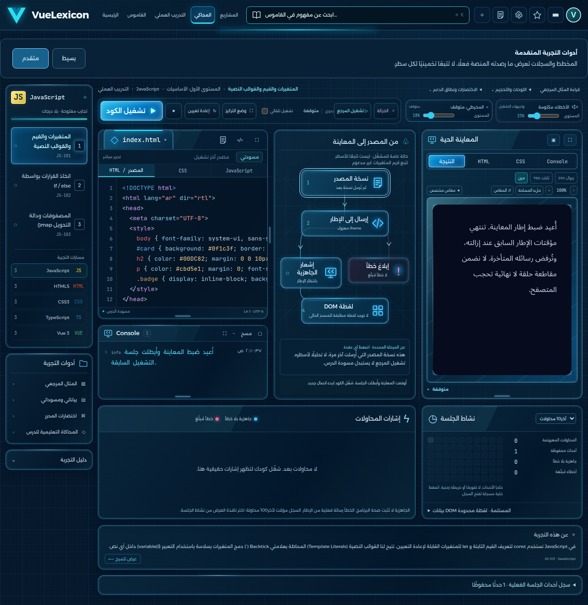
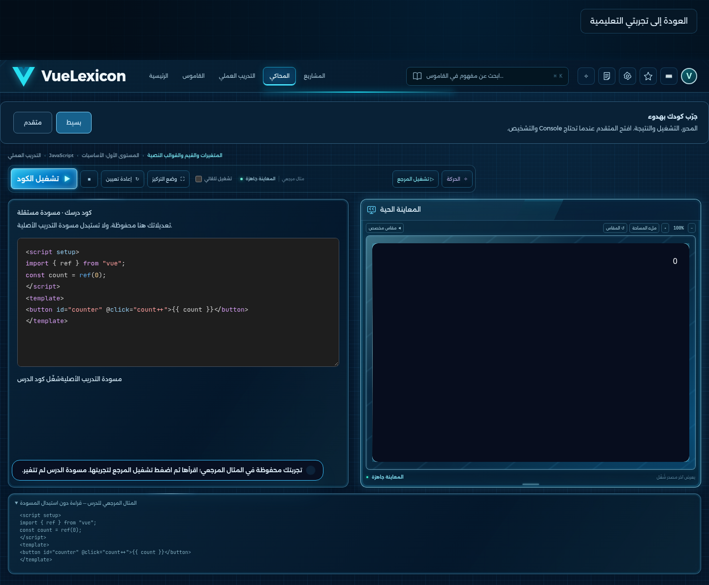
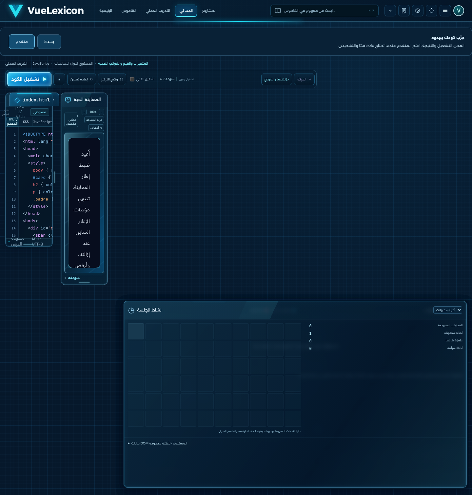
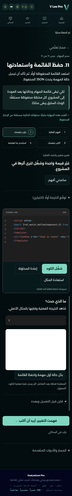

# مراجعة V Lex Pro بعد تحديث main — 14 نوفمبر 2026

**النتيجة:** المسار الجديد يعمل بأربع مراحل، ويمكن اجتياز محطات مدير المهام الإحدى عشرة وحفظها. توجد ثلاث أولويات للمحتوى والتكامل وثلاث ملاحظات استخدام موثقة أدناه. لم أعد بناء الموقع أو أطبق إصلاحًا على كوده في هذه الجولة.

**النسخة المفحوصة:** `d554fd14e5960c9b6a2c62155f6a7124735524c1`، رأس main الذي جُلب من GitHub، ويشمل دمج PR7. الفحص في worktree مستقل، مع بقاء مساحات العمل والتقارير السابقة. فرع التقرير `review/main-learning-20261114` يضيف أدلة وأداة مراجعة فقط؛ لا تعديل لملفات تشغيل الموقع أو أسرار أو إعدادات حساسة أو بيانات أشخاص، ولا دمج أو نشر.

## ما اختُبر فعليًا

|الفحص|النتيجة والدلالة|
|---|---|
|GitHub على main نفسه|قرأت سجل [التشغيل 43541982183](https://github.com/hofufihassan-wq/my-project/actions/runs/43541982183): **65/65 مجموعة ناجحة**، لا مجرد الاعتماد على تقرير قديم|
|مهمة نشر GitHub Pages|[43541981296](https://github.com/hofufihassan-wq/my-project/actions/runs/43541981296) ناجحة؛ هذا يثبت نجاح المهمة، وليس فتح الرابط من جهاز مستخدم|
|فحوص التحديث المحلية|6/6 مجموعات: الحالة 6/6، واجهة النماذج 14/14، التصحيح 30/30، أمثلة الدروس 60/60، تصحيح محطات المشروع 44/44، الأسطح والنسخة الشاملة 10/10|
|مرور جديد عبر واجهة الدروس|أكملت المتغيرات وfilter وVue ref من «افهم» إلى «جرّب» ثم «اكتب» و«استخدم»، مع تشغيل حقيقي وأسئلة وحفظ إنجاز|
|مدير المهام|أكملت المحطات الإحدى عشرة عبر أزرار الواجهة والحلول المرجعية، وتحققت من الانتقال للمحطة التالية وحفظ إنجاز كل محطة؛ ليست تجربة تعلم بشري مبتدئ|
|الحفظ|استعادة دقيقة لتقدم التجربة وكودها بعد إغلاق عملية المتصفح كاملة، مع بقاء المشاريع الستة السابقة. فحص الأسطح أعاد التصدير والاستيراد بملف حقيقي ومعلومات تجريبية|
|القاموس|فحص حالة العرض لكل 180 مصطلحًا: الملخص ظاهر والتفاصيل مطوية. فتحت التفاصيل والمحرر فعليًا وفحصت أمثلة map/filter/let/var|
|المحاكي|دخول من الترويسة ومن الدرس، بسيط/متقدم، تشغيل Vue حقيقي، حفظ مسودة التدريب مستقلة، وفحص التحكم بالصوت عند تغيير الوضع|
|العرض المتجاوب|360 و390 و412 و768 و1440 بكسل دون تجاوز عرض الصفحة في الأسطح المفحوصة؛ هذه **أحجام محاكاة وليست أجهزة فعلية**|

المتصفح المحلي Chromium **154.0.8037.57** على Linux، بملفات مستخدم جديدة. الأسماء والمدخلات في الصور بيانات تعليمية تجريبية. أرقام نجاح المجموعات لا تعني خلو التجربة من الملاحظات التالية؛ العقود الحالية تختبر مهارة كل تمرين ولا تشترط تراكم كل أدوات المشروع في آخر محطة.

## الدروس الأربع: ما نجح وما يحتاج صقلًا

المراحل واضحة والأداة الأساسية في كل مرحلة بارزة. التوقع والمساعدة والتفاصيل والمتطلبات والأدوات القديمة اختيارية، وزر متابعة الكتابة لا يعمل قبل نجاح المصدر الحالي. لم يظهر فقدان مسودة أو تعطل يمنع إكمال المسار في السيناريوهات المفحوصة.

نص الفكرة المختصر في الدروس الستين لا يتجاوز **178 حرفًا**؛ لذلك لا أوصي بإعادة اختصار المنهج أو إعادة كتابته. الاستثناء العملي في مدير المهام هو كثافة الكود المتأخر: مصدر المحطة 11 فيه سطر بطول **698 حرفًا**. على عرض الجوال يحتاج تمريرًا أفقيًا كثيرًا. يكفي توزيع الأسطر في هذا المثال مع بقاء المنطق والاختبارات؛ لا حاجة إلى تغيير تصميم الدروس كلها.



## الملاحظات والإصلاحات المقترحة

### P1 — مثال map المختصر يعرض filter

**إعادة الظهور:** القاموس ← `map()` ← «مثال بسيط». المثال الظاهر هو دالة اختيار مهام تستعمل `filter()` ولا تستعمل `map()`. والزر المرتبط يفتح نموذج filter، لأن المصطلحين مربوطان بدرس واحد، والواجهة تقدم `dictionaryLesson.trySource` على مثال المصطلح نفسه.

**الأثر:** المقدمة المختصرة صحيحة من حيث البنية، لكن المثال يشرح عملية مختلفة عن عنوان المصطلح. ظهرت أيضًا أمثلة const عند اختيار let/var بسبب أولوية مثال الدرس المشترك.

**اقتراح محدود:** استعمل مثال المصطلح الأصلي الصحيح ولغته في البطاقة المختصرة، وأبق رابط الدرس المرتبط منفصلًا. لا تنشئ صفحة أو درسًا جديدًا لهذا الإصلاح. أضف تحققًا بأن مثال map يستعمل map، وأن أمثلة let/var لا تستبدل بمثال const. المصدر: [dictionaryLesson في app.js](https://github.com/hofufihassan-wq/my-project/blob/d554fd14e5960c9b6a2c62155f6a7124735524c1/app.js#L2427) و[البطاقة المختصرة](https://github.com/hofufihassan-wq/my-project/blob/d554fd14e5960c9b6a2c62155f6a7124735524c1/index.html#L482).

التفاصيل مطوية أصلًا كما طلبت؛ لا حاجة لإعادة بناء القاموس. ملاحظة ثانوية: داخل تبويب المعنى، «اقرأ الشرح كاملًا» يكرر `description` نفسه؛ أزل التكرار المرئي مع إبقاء النص الكامل تحت التفاصيل، دون حذف بيانات المصطلح.



### P1 — المشروع النهائي لا يجمع ميزات المحطات السابقة

**ما رُصد:** المحطة 9 تعرض إدخالًا وزر إضافة وقائمة. المحطتان 10 و11 تعرضان مهمتين وزري تبديل، دون إدخال أو زر إضافة أو حذف. القياس الفعلي للمحطة 11: **0 مدخل، 0 زر إضافة، 0 زر حذف، صفّان**. المحطات السابقة محفوظة، والمشاريع الستة السابقة باقية؛ النقص في تكامل التطبيق النهائي المعروض.

**اقتراح:** اجعل المحطة 10 إعادة تنظيم لتطبيق المحطة 9 في مكوّنات، مع بقاء الإضافة وإدخال العنوان، وأضف الحذف بالهوية الذي تعلمناه. المحطة 11 تضيف الحفظ إلى التطبيق نفسه. حافظ على معرفات المحطات ومسوداتها ومخزن التعلم؛ لا تستبدل المشروع أو محرك التنفيذ.

**شرط قبول الإصلاح:** في آخر محطة أضف مهمتين، بدّل إحداهما، احذف الأخرى، أغلق التجربة ثم أعد فتحها وتحقق من العناوين والحالات. أضف هذا العقد إلى اختبار التكامل، بجانب الاختبارات الحالية 44/44 التي تبقى محفوظة. المصدر: [task-journey.js](https://github.com/hofufihassan-wq/my-project/blob/d554fd14e5960c9b6a2c62155f6a7124735524c1/task-journey.js).





### P1 — زر الإضافة داخل معاينة المحطة 9 لا ينفذ نقرة المستخدم

كتبت عنوانًا داخل المعاينة ونقرت «أضف»: بقي عدد الصفوف **1 قبل النقر وبعده**. الإطار `sandbox=""` يعرض لقطة خاملة بعد تنفيذ الاختبار، وهذه المحطة لا تملك حقل تفاعل خارجيًا أو زر إجراء خارجيًا. التحكم الخارجي موجود فعلًا في المحطة 8 ولتبديل الحالة في المحطة 11.

**اقتراح:** أضف للمحطة 9 مدخلًا وزر إضافة خارج اللقطة يشغّلان أحداث الكود المعزول، بنفس نمط الأدوات الموجودة. وضّح فوق اللقطة أنها نتيجة بعد التشغيل، كي لا تبدو الأزرار المعروضة معطلة دون تفسير. أبق العزل؛ **لا تفعّل صلاحيات الإطار لتمرير هذا الفحص**. يمكن توفير رابط المحاكي للتفاعل المباشر حين يدعم سياق المثال، مع احترام قيود التخزين الخاصة بالمحطة 11. المصدر: [أدوات التجربة والمعاينة](https://github.com/hofufihassan-wq/my-project/blob/d554fd14e5960c9b6a2c62155f6a7124735524c1/learning-journey.js).

### P2 — أرقام الأسطر لا تتابع تمرير المحرر

**إعادة الظهور:** ضع نحو 60 سطرًا في المحرر دون الحاجة لتشغيلها، ثم مرر الكود رأسيًا. القياس: `textarea.scrollTop=150`، وأرقام الأسطر بقيت عند `scrollTop=0`؛ ارتفاع المحرر 260px مقابل شريط أرقام 460px.

**اقتراح:** وحّد الارتفاع وline-height وpadding، وزامن تمرير شريط الأرقام مع textarea في أداة العرض الحالية. احتفظ بالكتابة الطبيعية وLTR وألوان الكود؛ لا مكتبة تحرير جديدة. المصدر: [code-presentation.js](https://github.com/hofufihassan-wq/my-project/blob/d554fd14e5960c9b6a2c62155f6a7124735524c1/code-presentation.js#L19) و[learning-journey.css](https://github.com/hofufihassan-wq/my-project/blob/d554fd14e5960c9b6a2c62155f6a7124735524c1/learning-journey.css).



### P2 — الوضع الافتراضي للمحاكي يختلف بحسب مدخل الوصول

ملف مستخدم جديد ← زر «المحاكي» في الترويسة: يفتح **المتقدم**. من «جرّب في المحاكي» داخل الدرس: يفتح **البسيط**. البسيط نفسه يخفي Console والمخطط والأدوات الثانوية، والمتقدم متاح عند الطلب، وهذا جيد.

**اقتراح:** عند عدم وجود تفضيل محفوظ افتح البسيط من كل المداخل؛ إذا اختار المستخدم المتقدم صراحة فاحفظ اختياره. لا تحذف الأدوات أو تغيّر هوية الأزرق والأحمر. [القيمة الافتراضية الحالية](https://github.com/hofufihassan-wq/my-project/blob/d554fd14e5960c9b6a2c62155f6a7124735524c1/app.js#L239).





### P2 — إخفاء الكتم مع استمرار صوت المحيط في البسيط

فعّلت المحيط في المتقدم ثم انتقلت للبسيط. بقي `ambientPlaying=true` بأربعة مصادر صوت، بينما زر التحكم اختفى. هذا فحص للرسم الصوتي والتحكم، وليس ادعاء سماع الصوت من جهاز فعلي.

**اقتراح:** أبق كتمًا صغيرًا واضحًا في شريط الوضعين، يستعمل التحكم القائم. تبقى قناتا الصوت ومستوياتهما التفصيلية في المتقدم؛ لا تستبدل النظام. يمر اختبار الإصلاح إذا أدى الكتم من الوضع البسيط إلى توقف الإشارة الفعلية، مع بقاء تفضيلات المستخدم الصحيحة.



## ما لم يُختبر

- **Windows فعلي: غير منفذ. هاتف فعلي: غير منفذ.** وافق المستخدم خلال هذه الجولة على الاكتفاء بالمتاح وبيان ذلك. تغيير عرض Chromium أو user agent لا يعد اختبارًا لهذين الجهازين.
- لم تُختبر لوحة مفاتيح الهاتف الفعلية، لمس iOS/Android، Safari، أو النطق المسموع من الجهاز. أحجام 360–412 هنا محاكاة مساحة عرض فقط.
- تعذر فتح [الموقع المنشور](https://hofufihassan-wq.github.io/my-project/) من البيئة: الوكيل رفض CONNECT بـ403 إلى `hofufihassan-wq.github.io`. هذا **ليس رد 403 من الموقع نفسه**. جرى التحقق من GitHub وسجل CI والنشر خارج الجهاز المحلي، لكن لا يوجد ادعاء باختبار واجهة الرابط الحي.
- لإكمال فحص الرابط من Codex يلزم إضافة **هذا المضيف المحدد فقط** إلى قائمة الشبكة المسموحة في إعدادات البيئة، ثم إعادة المحاولة. لم أغيّر السياسة أو الأسرار أو إعدادات المستودع.



## حدود الأدلة والتصحيح في أداة المراجعة

مرور الواجهة الجديد أعطى 22/23 في المحاولة الأولى: فحص الصوت انتظر `ready`، بينما الحالة الصحيحة للمحيط هي `playing`؛ `ready` تخص قناة التنبيهات. صححت التوقع في أداة المراجعة، وأعدت **فحص الصوت وحده** فنجح 1/1 وأثبت استمرار المحيط مع اختفاء زر الكتم. لم أغير كود الموقع لإرضاء الاختبار. [المحاولة الأصلية](evidence/flow-initial.json) و[الفحص المركز](evidence/audio-recheck.json) محفوظان.

هذه مراجعة سلوك باستخدام حلول مرجعية ومعلومات تجريبية، وليست دراسة مستخدمين مبتدئين أو شهادة أن كل متعلم يفهم المحتوى. لا يوجد تغيير لبيانات حقيقية أو حذف ميزة أو إعادة تنفيذ لمرحلة مكتملة. [الملخص الآلي](evidence/SUMMARY.json) و[نتائج المجموعات الست](evidence/targeted-suites.json).

## الخطوة التالية المقترحة

1. دفعة صغيرة للقاموس: إصلاح مثال المصطلح وإزالة التكرار المرئي، مع تحقق map/filter/let/var وبقاء التفاصيل والمحرر والمفضلة والنطق.
2. دفعة تكامل للمشروع: إبقاء ميزات المحطات عند إدخال المكونات والحفظ، وتوفير تجربة إدخال/إضافة فعلية للمحطة 9 ضمن العزل القائم. لا تعديل للمنهج كله أو محرك التنفيذ.
3. دفعة صقل للمحرر والمحاكي: تمرير الأرقام، تنسيق أسطر المشروع، افتراضي بسيط عند غياب التفضيل، وكتم متاح دائمًا. ثم إعادة الفحوص المتأثرة وCI، واختبار Windows والهاتف الحقيقي عند توفرهما.

**هذه اقتراحات؛ لم تنفذ الإصلاحات في فرع المراجعة.** لا أنصح بإعادة العمل من البداية. النسخة الجديدة حسّنت تنظيم التعلم، والأولوية لسد فجوات الأمثلة والتكامل المحددة أعلاه.

## أوامر النسخ واللصق

### فتح التقرير ونتائج main — PowerShell

```powershell
Start-Process "https://github.com/hofufihassan-wq/my-project/blob/review/main-learning-20261114/docs/reviews/2026-11-14/REPORT_AR.md"
Start-Process "https://github.com/hofufihassan-wq/my-project/actions/runs/43541982183"
```

### فحص لاحق على Windows حقيقي دون لمس المشروع الحالي

يتطلب Node.js وMicrosoft Edge مثبتين مسبقًا. هذا **أمر جاهز لإعادة الفحص مستقبلًا، وليس اختبار Windows منفذًا في هذه الجولة**. الأداة محفوظة بإصدار ثابت، وتفتح ملف متصفح تجريبيًا جديدًا وتكتب بيانات تجربة فقط. لا تغير ExecutionPolicy أو جدار الحماية أو ملفات مشروعك أو أسرارك. تبقى تجربة الهاتف الفعلي منفصلة.

```powershell
$reviewDir = Join-Path $env:TEMP ("VLex-Review-" + [guid]::NewGuid().ToString("N"))
New-Item -ItemType Directory -Path $reviewDir | Out-Null
Invoke-WebRequest "https://raw.githubusercontent.com/hofufihassan-wq/my-project/caff98bad5be8eabf428701634d446934fd1c835/tools/review/main-learning-review.cjs" -OutFile (Join-Path $reviewDir "review.cjs")
npm install --prefix "$reviewDir" --no-save --ignore-scripts --no-audit --no-fund --package-lock=false playwright-core@1.57.0
node (Join-Path $reviewDir "review.cjs") --require-windows --url "https://hofufihassan-wq.github.io/my-project/" --output (Join-Path $reviewDir "results")
Get-Content (Join-Path $reviewDir "results\review-results.json") -Raw
```

الأداة ترفض وصف Linux بأنه Windows عند `--require-windows`. الأوامر لا تنفذ دمجًا أو حذفًا أو نشرًا. نتائجها المستقبلية تخص نسخة الموقع المقدمة وقت تشغيلها، لذلك قارِن main والـCommit المنشور حينئذٍ قبل نسبتها إلى نسخة هذا التقرير.
