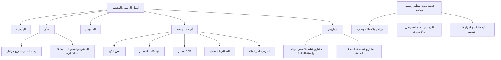
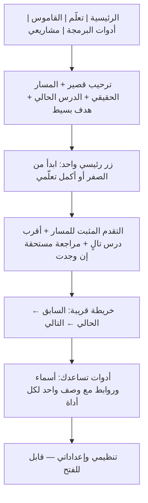
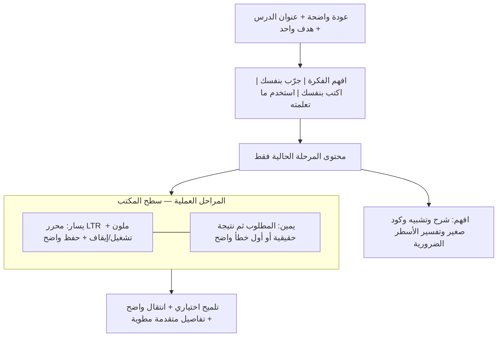
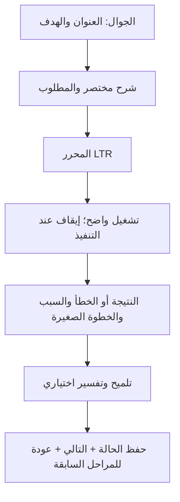

# مخطط التنقل والرئيسية والدرس — للاعتماد قبل التنفيذ

**هذا مخطط، لا واجهة مطبقة.** مرحلة A لا تعدل HTML أوJavaScript أوCSS للموقع. ألوان الأمثلة في المخططات ليست تغييرًا للثيمات، ولا صورًا مولدة تدّعي أنها من التطبيق.

## 1. الهيكل الرئيسي المقترح

«تعلّم» يفتح رحلة التعلم الأساسية، لا يفتح عدة أنظمة متنافسة. تختار الأدوات محركها الحالي، و«مشاريعي» تفصل التعليمي عن الشخصي بوضوح دون تحويل السجلات بينهما.

على الجوال: شريط مختصر واحد أو قائمة أقسام مختصرة قابلة للفتح، بارتفاع لا يحجب التعلم؛ لا شريطين متراصين يكرران الأدوات. تصميمه النهائي يُراجع في B عند360 و390، مع زري العودة الحاليين والتمرير والتركيز. لا اعتماد على hover، وتفتح القائمة بلوحة المفاتيح وتغلق بـEscape وتعيد التركيز إلى زرها.

يبقى المحاكي مساحة عمل زجاجية مستقلة بشريطه وأدواته. شريط الموقع العام مخفي فيه أصلًا في النسخة الحالية؛ لا نفترض ضرورة استبدال شريطه الخاص. أي تغيير لهيئته أو ألوانه يتطلب مقارنة ودليلًا وموافقة منفصلة. تنظيم الدخول والعودة لا يجيز تغيير محركه.

## 2. مخطط الرئيسية

### قواعد الحالة والمحتوى

- **زائر جديد:** لا مسودة تعلم ولا تقدم قديم صالح؛ ترحيب بالبداية و«ابدأ من الصفر». الضغط يفتح الدرس الأول فقط؛ لا clear ولا إعادة ضبط.
- **متعلم عائد:** عنوان الدرس والمرحلة المحفوظة و«أكمل تعلّمي». القديم يظل محفوظًا ويظل قابلًا للوصول.
- **المسار:** من لغة/نوع الدرس الحقيقي، بما فيه HTML/CSS التأسيسيان ومدير المهام. لا يختزل HTML/CSS إلى JavaScript كما يحدث حاليًا.
- **التقدم:** من دليل الإنجاز القائم، لا الزيارة. الرقم ومقامه للمسار نفسه. الإنجاز السابق والمحاولة الحالية يميزان عند الحاجة دون حذف أي منهما.
- **الخريطة:** عند أول درس تعرض الحالي والتالي فقط؛ في الوسط السابق/الحالي/التالي؛ في النهاية السابق/الحالي. لا عقدة سابقة وهمية أو عشرات الدروس.
- **الأسماء:** عنوان واحد للمفهوم نفسه في البطاقة والخريطة، من تعريف العرض الحالي؛ تبقى المعرفات الأصلية.
- **المراجعة:** أقرب موعد فعلي مستحق برابط صغير، لا رقم وهمي. بقية المراجعات في القسم الثانوي.
- **الأدوات:** صفوف/روابط خفيفة مع وصف، لا خمس بطاقات ضخمة تنافس CTA.
- **التنظيم:** مهام وملاحظات وتقويم ومشاريع شخصية وإحصاءات وثيمات داخل منطقة ثانوية واضحة. تبقى تنبيهات فشل الحفظ ظاهرة، ولا تُطوى مع الإعدادات.

الأوصاف المقترحة: «القاموس: معنى المصطلح ومثاله»، «شرح الكود: الأسطر والكلمات المعروفة»، «JavaScript: تشغيل ونتائج وأخطاء»، «CSS: شاهد تأثير الخصائص»، «المحاكي: جرّب صفحة ضمن قدرات المعاينة المعزولة». الهدف تمييز الوظائف، لا توحيد المحركات.

## 3. مخطط الدرس على سطح المكتب والجوال

التفاصيل والمراجع والأخطاء السابقة مطوية. الحفظ أثناء الكتابة يبقى كما هو، ولا يستبدل المصدر أثناء التشغيل أو التنقل. الاستعادة تحتاج تأكيدًا. النسخ لا يعلن نجاحًا قبل نجاح clipboard، وتبقى textarea الطبيعية قابلة للاختيار والكتابة. لا مكتبة تحرير أو حركات كثيفة جديدة.

## 4. ضمان بدائل جميع الوجهات قبل إزالة تكرار قديم

هذه حالات داخل التطبيق الواحد، وليست18 عنوان URL مستقلًا. المعاينات جزء من الأدوات ولا نضيف صفحة جديدة لها.

|الوجهة الحالية|طريق قائم تحققنا منه أو من ربطه|المكان المقترح|
|---|---|---|
|home|الشعار/الرئيسية|الرئيسية|
|learn|أكمل تعلمي، أو تعلّم معي من الشريط الثانوي|تعلّم، مع استكمال آخر درس|
|lexicon|القاموس والترويسة وأداة الرئيسية|القاموس، ومعنى سريع سياقي من الدرس|
|explain|أداة الرئيسية والشريط الثانوي|أدوات البرمجة ← شرح الكود|
|jsLab|أداة الرئيسية والشريط الثانوي|أدوات البرمجة ← JavaScript|
|cssLab|أداة الرئيسية والشريط الثانوي|أدوات البرمجة ← CSS|
|practice/simulator|الرئيسية/الترويسة/الدرس|أدوات البرمجة ← المحاكي، وشريط عمله المستقل|
|practice/training|التدريب العملي في الترويسة|أدوات البرمجة ← التدريب الحر|
|taskJourney|شاهد مشروعي في الرئيسية|مشاريعي ← التعليمي ← مدير المهام؛ ورابط سياقي من التعلم|
|guided|الفهرس الكامل من القسم الثانوي|تعلّم ← الفهرس المتقدم والمسودات السابقة؛ ومشاريع التعلم تستخدم محركها الحالي|
|course|لوحة التنظيم السابقة ← افتح دروسك|تعلّم ← الدروس والمراجعات السابقة32|
|arrow|الدروس السابقة ← افتح نموذج Arrow|تعلّم ← النموذج المعتمد والأدوات المتقدمة|
|foundation/projects|المشاريع من الرئيسي/القسم الثانوي|مشاريعي، مع فصل التعليمي/الشخصي|
|foundation/kanban|تبويب لوحة المهام داخل التنظيم|تنظيمي ← المهام|
|foundation/notes|تبويب الملاحظات/القسم الثانوي|تنظيمي ← الملاحظات|
|foundation/calendar|تبويب التقويم/القسم الثانوي|تنظيمي ← التقويم|
|overview|لوحة التنظيم والإحصاءات السابقة|تنظيمي ← الإحصاءات السابقة موضحة المصدر|
|settings|أيقونة الإعدادات/القسم الثانوي|قائمة الإعدادات والثيمات وبياناتي|

لن يُزال شريط أو مدخل قديم في B إلا بعد اختبار الوصول البديل بالنقر ولوحة المفاتيح، لا بمجرد وجود دالة تفتح القسم برمجيًا. تبقى روابط العودة. يشتق القسم الحالي من الوضع والقسم الفرعي معًا، فلا تُعلّم «المشاريع» كقسم حالي عند قراءة الملاحظات لمجرد أن كليهما foundation.

## 5. خطة المراحل والملفات وحدودها

|المرحلة|التغيير المسموح بعد اعتمادها|الملفات المرشحة فقط|بوابة التحقق|
|---|---|---|---|
|A الحالية|تقارير وصور ومخططات وبصمات ومرجع احتياطي|docs/ux-phase-a/2026-11-17 فقط|قراءة التقارير واعتماد المخطط؛ لا تغيير UI|
|B|تبسيط الرئيسي والتنقل، حالة مبتدئ/عائد، المسار الصحيح، أوصاف الأدوات وفصل مسارات التنظيم|index.html، learning-journey-home.js، جزء التنقل فقط من app.js، نطاقات home/nav من learning-journey.css وlearning-refinement.css|وصول جميع الوجهات، بداية وعودة،360/390/768/1440، الثيمات5، لا تغيّر بيانات|
|C|وضوح التعليمات والمحرر والتلميح والنتيجة، مزامنة الأرقام، النسخ والاستعادة والانتقال دون أقفال وصول|learning-journey.js، code-presentation.js، CSS الرحلة؛ شرح النماذج في learning-journey-content.js بعد مراجعة تعليمية محددة|JS الأول وVue كاملان، خطأ موثوق، إيقاف، مسودات وعودة، وعدم منح إنجاز للفتح|
|D|وصول الأدوات وسياق الرجوع، المثال المختصر للمصطلح، كتالوج المشاريع ومستوياتها الموجودة|دوال الربط في app.js وindex.html، learning-projects.js؛ وصف عند دخول المختبر فقط عند الحاجة|القاموس والمفضلة والرجوع، فصل مسودات الأدوات، التصدير والاستيراد، لا تعديل lexicon-data.js|
|E|صقل متجاوب محدود ومقارنة صور فعلية قبل/بعد واختبارات حديثة|CSS للنطاقات المعدلة وتقارير/tests المتأثرة|بناء وأصول، انحدار بيانات ودروس وقاموس ومشاريع ومختبرات ومحاكي، تركيز وتباين وتقليل حركة|

الأسماء احتمالات مبررة وليست إذنًا بملف كامل، خصوصًا app.js. محركات التنفيذ والنسخ والتخزين لا تدخل تعديلًا تنظيميًا. إصلاح تكامل مشروع المهام الأخير تذكرة محتوى مستقلة يُعرض نطاقها، ولا ينزلق إلى إعادة تنفيذ الستة أو محركها خلال B.

كل مرحلة Commit واضح على فرعها، مع جدول ملفات/سبب/اختبار/مشكلة متبقية. لا تبدأ التالية قبل الموافقة. لا دمج في main أو نشر بمجرد اعتماد مخطط أو مرحلة؛ النشر التلقائي على main يجعل موافقة الدمج قرارًا مستقلًا.

## 6. ضمانات التنفيذ

لا تغيير IDs أو storage keys، ولا clear أو استبدال تلقائي للمسودات، ولا تنفيذ مستورد تلقائيًا. الحالات القديمة والتقدم المحفوظ يبقيان في قسميهما. لو ظهر احتياج إلى مخطط بيانات أو مكتبة/خدمة جديدة فهذه موافقة مستقلة وخطة ترحيل؛ لا نفترضها ضمن موافقة التنقل.

تبقى iframe وWorker وحدودهما، والمحاكي بهويته المستقلة، والمكتبات المحلية والثيمات الخمسة. المطلوب تحسين ترتيب الوصول والمحتوى، لا تغيير الألوان الأساسية أو إضافة تتبع وتسجيل دخول ومزامنة.
