# المقارنة البصرية — الحالي والمقترح

**«قبل» هنا صور فعلية مأخوذة من التطبيق الحالي في17نوفمبر2026. «بعد» مخطط مقترح في هذه المرحلة، وليس لقطة واجهة منفذة.** لا صور مولدة، ولا تعديل للواجهة للحصول على صورة بعد قبل موافقة المستخدم. المقارنة الفعلية بعد التنفيذ تُضاف في E بنفس أحجام العرض وبيانات الاختبار.

## الرئيسية الحالية —1440px

المسار القريب والتنظيم الثانوي موجودان بالفعل. التحسين يستهدف الرسالة والربط، لا استبدال الصفحة كلها.

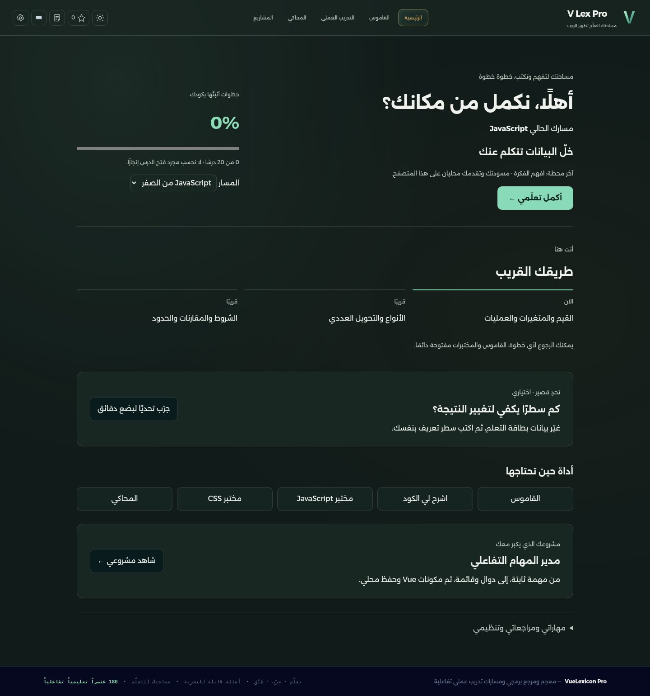

|قبل: الحالي|بعد: المخطط المطلوب اعتماده|
|---|---|
|«نكمل من مكانك؟/أكمل تعلّمي» حتى أول زيارة|ترحيب و«ابدأ من الصفر» عند غياب بيانات تعلم؛ استكمال عند وجودها، دون إعادة ضبط|
|المسار صحيح لـJS/Vue، غير صحيح عند العودة لـHTML/CSS|العنوان والخريطة والمقام من لغة/نوع الدرس الجاري|
|عقدة الخريطة تحمل اسمًا أصليًا مختلفًا عن عنوان النموذج|اسم مفهوم واحد في البطاقة والخريطة، مع نفس المعرف|
|ثلاث عقد منذ أول درس|العقد المتاحة من سابق/حالي/تالٍ؛ لا درس سابق وهمي|
|أسماء أدوات فقط وتحدٍ اختياري له زر كبير آخر|CTA تعلم أولويته أعلى؛ أدوات بأوصاف مختصرة، والتحدي ثانوي|

[المخطط الكامل للرئيسية](NAVIGATION_REDESIGN_PLAN_AR.md#2-مخطط-الرئيسية).

## كثافة التنقل في الإحصاءات السابقة

ثلاث مناطق متزامنة تضم5 عناصر رئيسية و6عناصر ثانوية و13رابطًا جانبيًا. المخطط يعالج تكرار المقاصد مع إبقاء اللوحة وبياناتها.

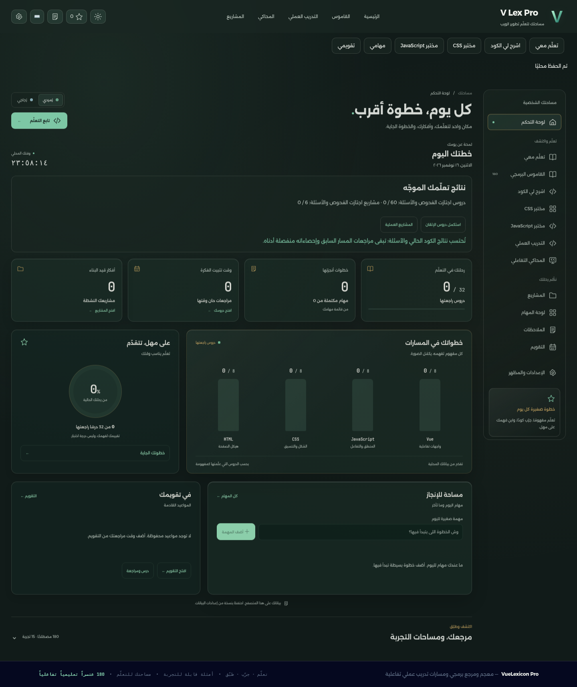

**المقترح:** خمسة أقسام عامة، وقائمة تنظيم ثانوية، وروابط سياقية عند الحاجة. لا إزالة لأي مدخل قبل اختبار بديله؛ المحاكي يحتفظ بشريط عمله المستقل، وليس دمجه بصريًا في هذه اللوحة.

## الدرس الحالي والمطلوب الحفاظ عليه

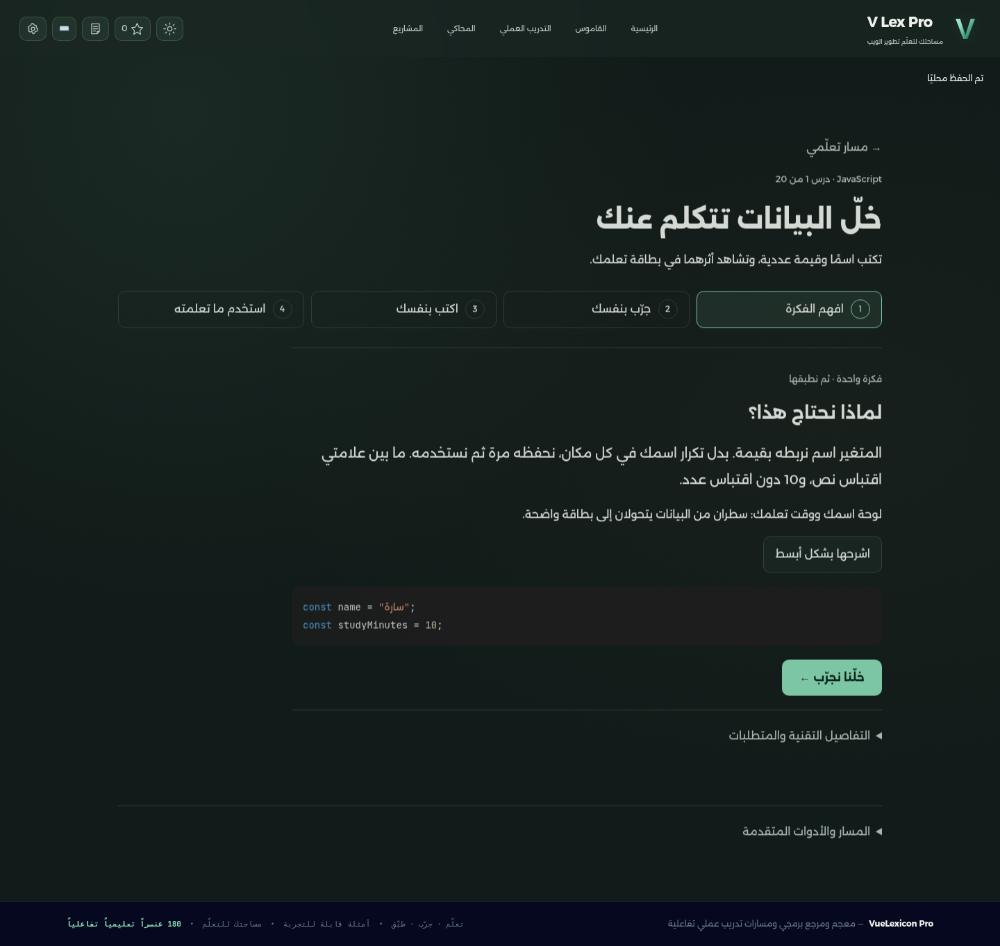

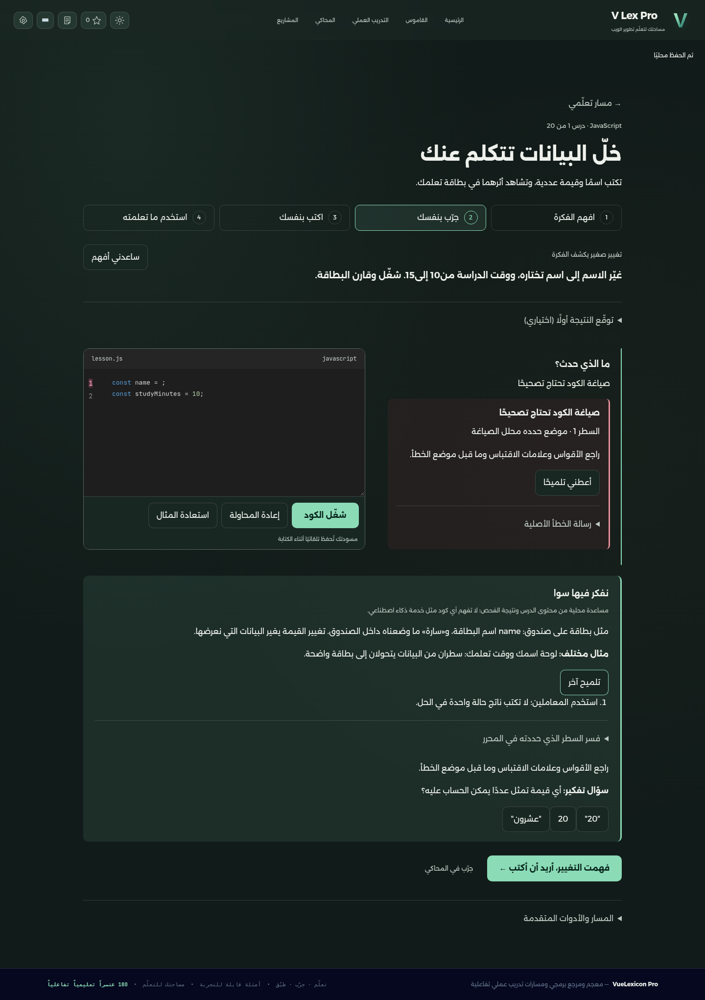

المقترح يبقي المراحل الأربع، والترتيب: الهدف ← المطلوب ← المصدر ← النتيجة ← التلميح ← الانتقال. يبرز أول خطأ، ويطوي الفحوص الأخرى والتفسير والمراجع. نص الفكرة الحالي موجز؛ لا نحتاج حائط نص جديد ولا إعادة كتابة كل الدروس. تحسين الأرقام والنسخ وصياغة التعليمات يُنفذ في C بعد الاعتماد.

## القاموس والأدوات

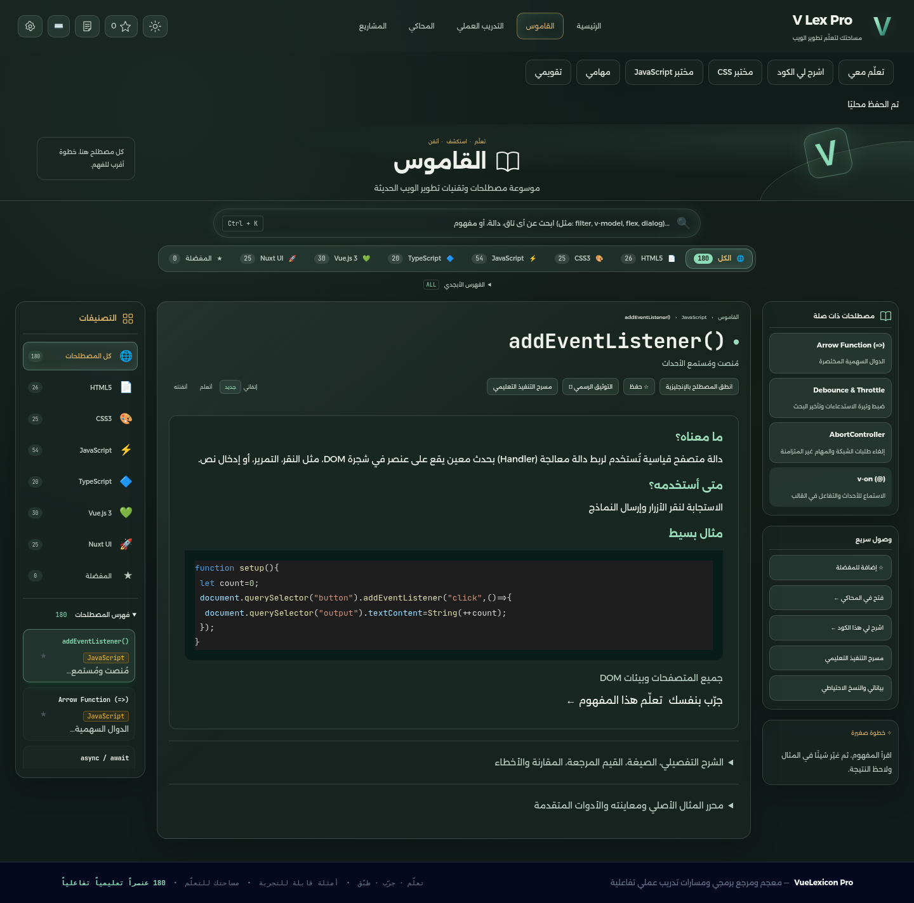

التفاصيل مطوية أصلًا. المقترح يصحح اختيار مثال المصطلح المختصر، ويضيف معنى سياقيًا وعودة للدرس، مع بقاء القاموس مستقلًا والمفضلة والنطق والتحرير.

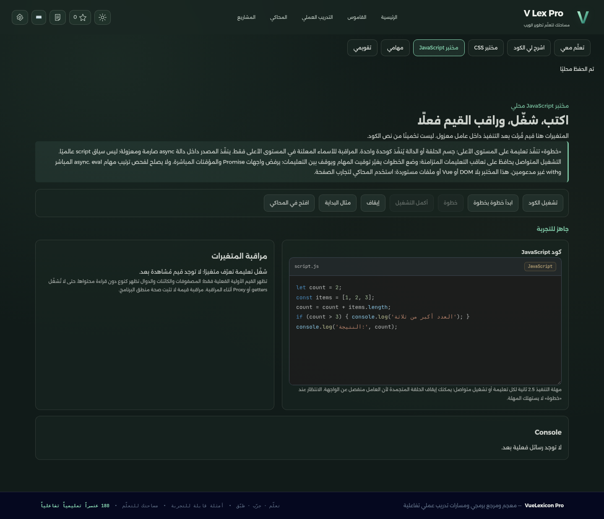

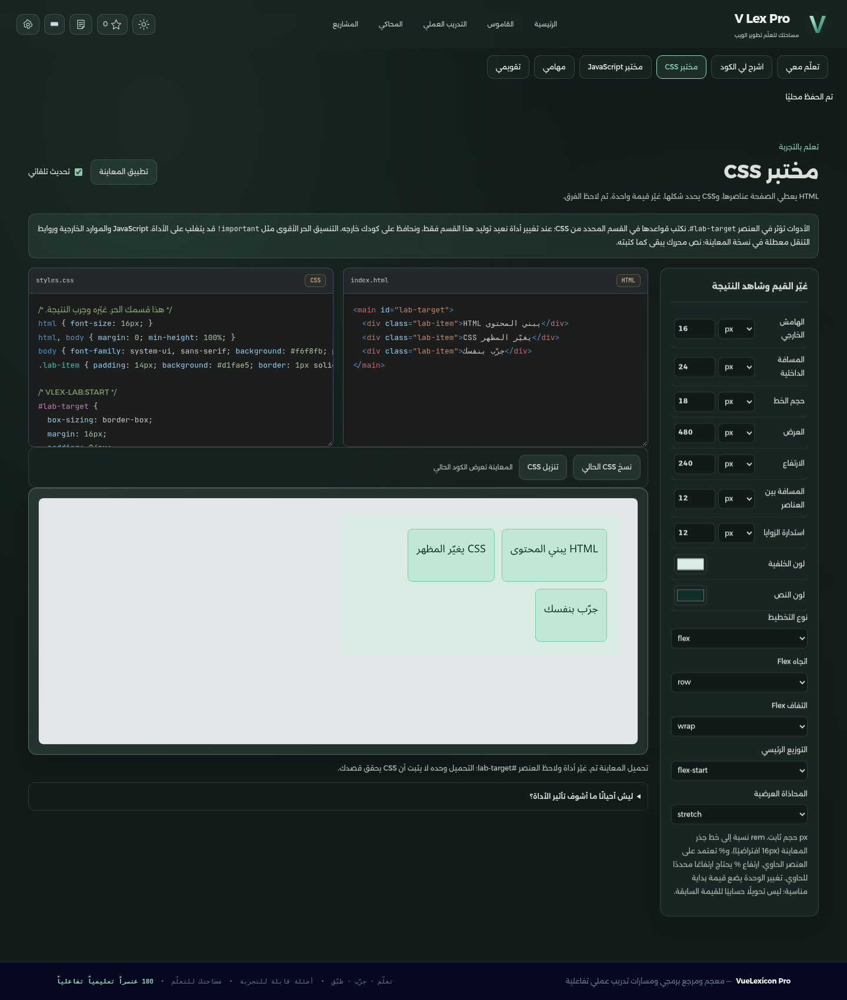

هذه أدوات مختلفة في القدرات والحفظ. المقترح يوضح الوظيفة قبل التشغيل ويجمع طرق الوصول، ولا يوحّد المحركات أو يغير نتيجة CSS.

## المشاريع

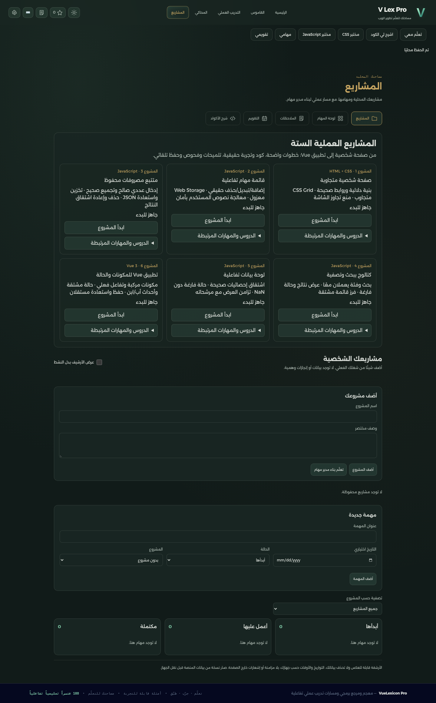

**المقترح:** فصل «تعليمية» و«شخصية»، وإظهار مستوى level والمهارات الموجودة. الستة ليست بطاقات تخطيط وهمية: توجد أنشطة وتقييم حقيقي حاليًا. مدير المهام11محطة يُعرض بنطاقه الفعلي، مع بند تكامل مستقل لآخر المحطات، لا وعد تطبيق نهائي لم يثبت.

## المحاكي الحالي

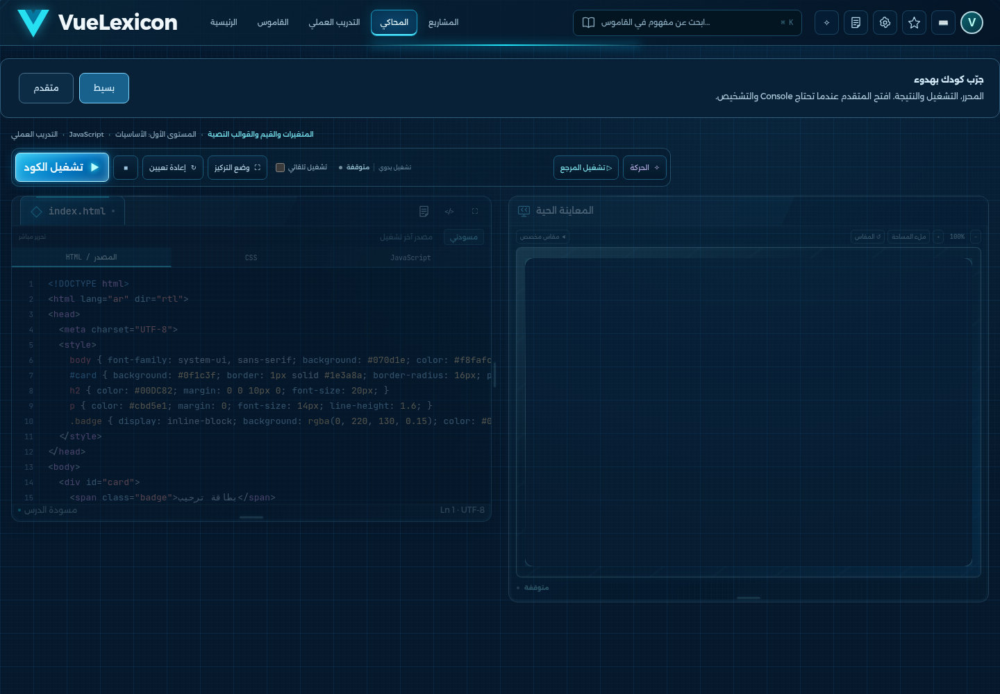

لا تغيير لزجاجه أو الأزرق/الأحمر في مخطط A. المقترح وظيفي: وصف حدوده وعودة واضحة، وبسيط عند غياب تفضيل، وكتم متاح. تغيير تخطيطه/هويته يحتاج موافقة منفصلة.

## الجوال والثيم الزجاجي

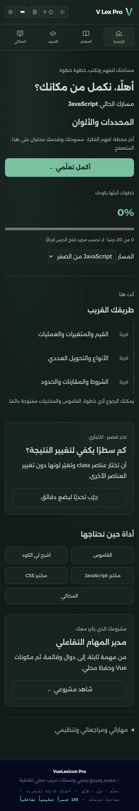

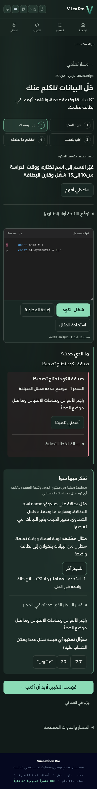

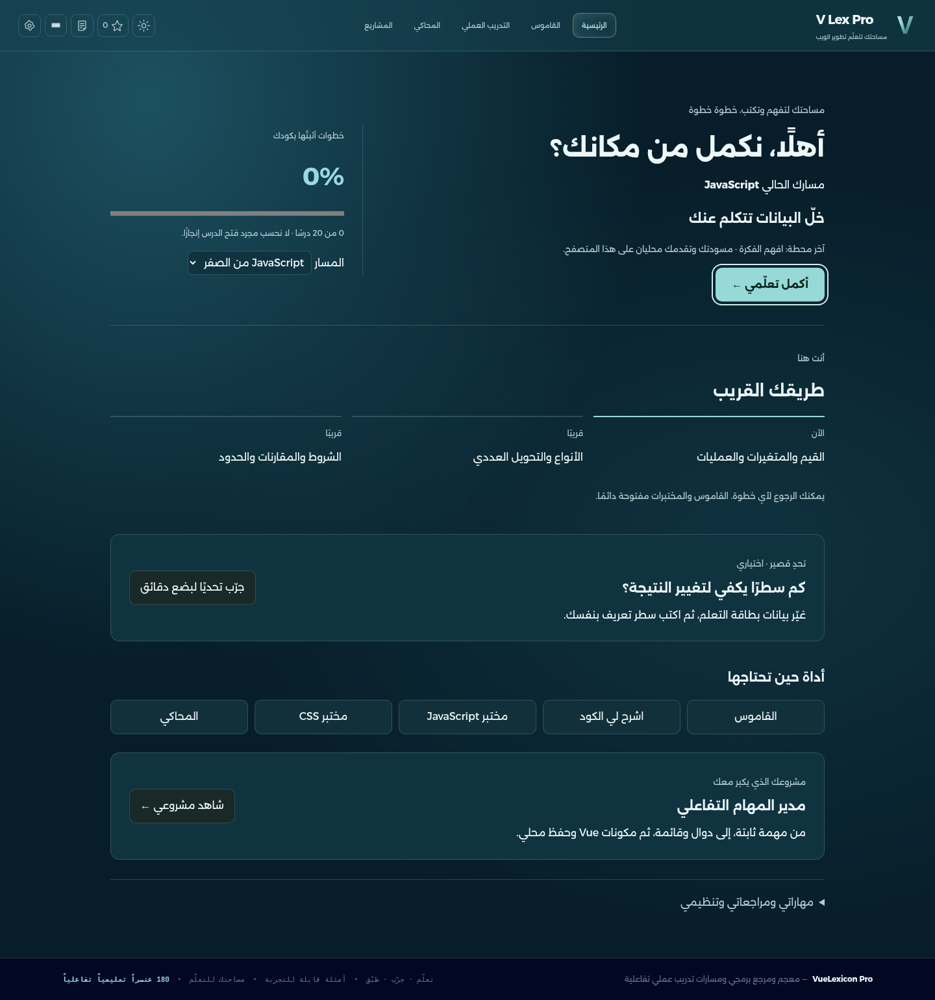

المقترح على الجوال: تنقل مختصر لا يغطي المحتوى، ثم شرح ومطلب ثم محرر ثم نتيجة. تحافظ CSS على360 و390 و768 و1440، وخط الكود LTR والنص RTL والثيمات الخمسة. قياس التركيز والتباين المفصل في [نتائج الفحص](UX_TEST_RESULTS_AR.md).

لن توسم هذه الصور «بعد»؛ حالتها الحالية مرجع المقارنة المستقبلية. لا تغيير جذري للألوان معتمد في هذه الحزمة.
